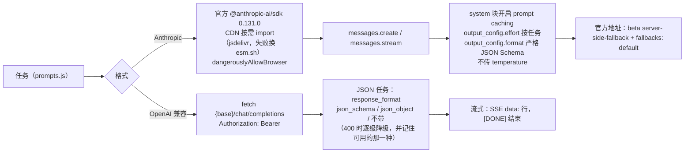
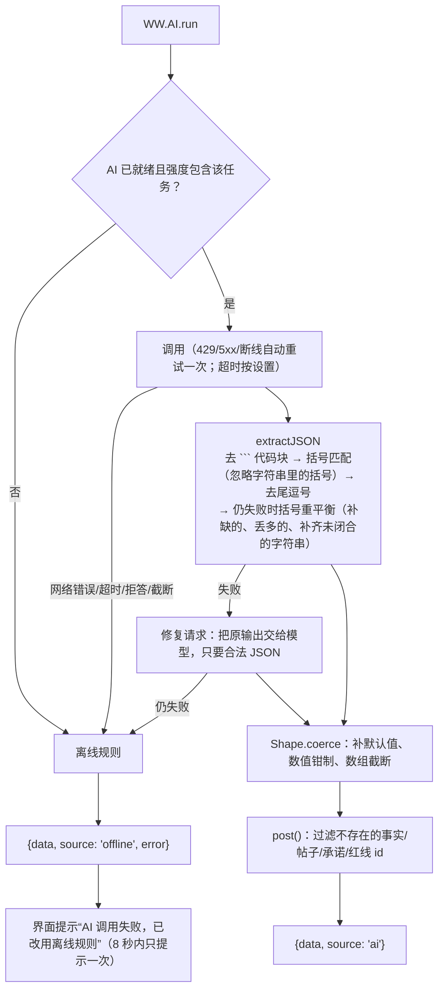
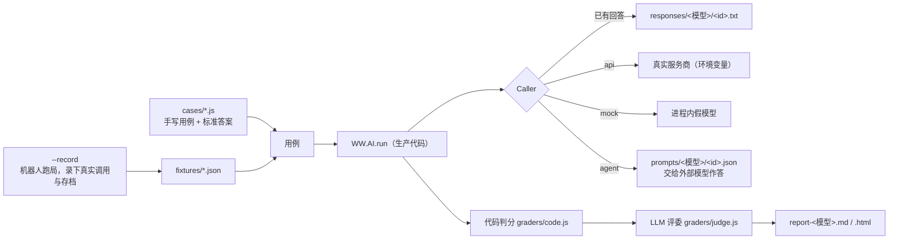

# AI 接入（AI）

游戏里 AI 负责“写”和“判”：补全公文、评审打分、按自然语言条件筛帖、按节奏方向写水军评论、生成每回合的网评与热搜、写客户巨信、判断举报是否属实、写结案报告，以及在编辑器里一句话生成关卡。**所有数值都由引擎计算**——AI 的打分有上下限、会被钳制，AI 不可用时每个任务都有离线规则兜底，游戏照样能完整玩下去。

---

## 1. 配置

在游戏或编辑器里点「AI 设置」：

| 设置 | 说明 |
|---|---|
| 服务商 | 预设会自动填好接口地址和常用模型，也可以选“自定义” |
| 模型 | Claude 默认 `claude-opus-5-5`；想更快更省可以选 `claude-sonnet-5-5` 或 `claude-haiku-5-5` |
| 接口地址 | Base URL |
| API Key / Key 保存方式 | **交给本地服务保管**（用 `start.bat` / `start.sh` 启动时的默认选项，推荐）：浏览器不留明文，见第 3 节「Key 托管」；**保存在本浏览器**：localStorage 明文；**仅本次会话**：关闭标签页即清除 |
| AI 强度 | **完整**：全部任务用 AI；**精简**：只有公文补全/润色/评审、回合网评、铁拳判定、结案报告用 AI，其余走离线规则（更省）；**离线**：不调用 AI |
| 结构化输出 | Anthropic 格式专用，用 `output_config.format` 强制 JSON；中转不支持时会自动降级 |
| 拒答时服务端自动回退 | Anthropic 官方地址专用，默认开启 |
| JSON 模式 / Temperature | OpenAI 兼容格式专用 |
| 公文补全流式输出 | 逐字显示 |
| 本地代理 | 见第 3 节 |

「测试连接」会发一个极小的请求验证配置；「AI 调用日志」能看到每次调用的提示词、原始返回、耗时和 token 用量（不记录 Key），方便关卡作者调提示词。

### 服务商预设

| 预设 | 格式 | 接口地址 | 示例模型 |
|---|---|---|---|
| Claude（Anthropic 官方） | Anthropic | `https://api.anthropic.com` | `claude-opus-5-5` / `claude-sonnet-5-5` / `claude-haiku-5-5` |
| Claude（Anthropic 格式中转） | Anthropic | 中转服务商提供 | 同上 |
| DeepSeek | OpenAI 兼容 | `https://api.deepseek.com` | `deepseek-chat` |
| 通义千问（阿里云百炼） | OpenAI 兼容 | `https://dashscope.aliyuncs.com/compatible-mode/v1` | `qwen-plus` |
| Kimi（月之暗面） | OpenAI 兼容 | `https://api.moonshot.cn/v1` | `moonshot-v1-32k` |
| 智谱 GLM | OpenAI 兼容 | `https://open.bigmodel.cn/api/paas/v4` | `glm-4-plus` |
| 豆包（火山方舟） | OpenAI 兼容 | `https://ark.cn-beijing.volces.com/api/v3` | 填推理接入点 ID |
| 硅基流动 | OpenAI 兼容 | `https://api.siliconflow.cn/v1` | `deepseek-ai/DeepSeek-V3` |
| OpenRouter | OpenAI 兼容 | `https://openrouter.ai/api/v1` | `deepseek/deepseek-chat` |
| Google Gemini | OpenAI 兼容 | `https://generativelanguage.googleapis.com/v1beta/openai` | `gemini-2.5-flash` / `gemini-2.5-pro`（Key 在 Google AI Studio 获取） |
| 本地 Ollama | OpenAI 兼容 | `http://localhost:11434/v1` | `qwen2.5:14b`（无需 Key） |
| 本地 LM Studio | OpenAI 兼容 | `http://localhost:1234/v1` | 填 LM Studio 中已加载模型的标识（无需 Key） |

> LM Studio：需要先在 Developer 页启动本地服务器，并在服务器设置里打开 **Enable CORS**（或者勾选本地代理走 `tools/serve.py`）。它的 JSON 模式只接受 `json_schema`，所以这个预设直接发严格 JSON Schema（和 Claude 的结构化输出用同一份 schema），由 LM Studio 按语法约束生成，输出一定是合法 JSON。加载模型时建议把上下文长度（Context Length）设到 **32k 以上**：LM Studio 常见的默认值 16k 对思考模型偏紧，思考 token 也占上下文，可能还没写正文就被截断（游戏会提示“输出被截断：提示词 X + 输出 Y token（其中思考 Z）”）。

---

## 2. 两种适配器



- **Anthropic**：浏览器直连需要的 `anthropic-dangerous-direct-browser-access` 头由 SDK 自动加上。按任务设置 `effort`：筛帖、网评、水军、控评、软文、自定义道具等用 `low`；公文补全/润色/评审、铁拳判定、结案报告、编辑器分区补全用 `medium`；编辑器一句话生成关卡的前 3 段用 `medium`、任务和事件段用 `high`。`stop_reason` 为 `refusal` 或 JSON 任务被 `max_tokens` 截断时视为失败，回退离线。如果中转服务不认 `output_config`/`effort`/`fallbacks` 等参数（返回 400），会自动切换到兼容模式重发。
- **OpenAI 兼容**：系统提示词末尾会附上 JSON 结构说明；`max_tokens` 上限 8000。开启「JSON 模式」时按顺序尝试三种 `response_format`：预设声明支持 schema 的（目前是 LM Studio）先发 `json_schema`（严格 JSON Schema），其余先发 `json_object`；接口返回 400 就换下一种，最后不带 `response_format`。成功的那一种按“接口地址 + 模型”记在内存里，之后的请求直接用它，不再先吃一次 400；改动设置后会重新探测。
- **输出上限**：远程接口 `max_tokens` 封顶 8000（不少服务商不接受更大的值）；本地接口（`localhost` / `127.0.0.1`）不封顶，直接用任务自己的预算（多为 16000），Gemini 预设封顶 16000。思考模型的思考 token 也算在 `max_tokens` 里，上限太低时正文会被截断。
- **思考强度**：标了支持的预设（LM Studio、Gemini）会带 `reasoning_effort`，比任务的 `effort` 低一档：`low`→`none`（不思考）、`medium`→`low`、`high`→`medium`。游戏里的 low 任务（网评、水军、控评等）都是纯写作，思考只会拖慢速度、吃掉输出额度。接口如果因为这个参数返回 400，就去掉它重发，并对这个接口记住不再带。设置里的「思考强度」可以改成固定的关闭 / 低 / 中 / 高（评测时用 `WW_EVAL_REASONING`）。

---

## 3. 跨域与本地代理

浏览器里直接调用接口要求服务商允许跨域（CORS）。如果你的服务商不允许，用项目自带的本地代理：

```bash
python tools/serve.py
```

然后打开 `http://127.0.0.1:8765/Start.html`，在「AI 设置」里勾选“通过本地代理转发请求”。请求会变成：

```text
http://127.0.0.1:8765/llm-proxy/<base64url(接口地址)>/chat/completions
```

代理原样转发请求头和请求体，并把响应（包括流式 SSE）原样传回。它只监听 `127.0.0.1`，只认 `127.0.0.1:<端口>` / `localhost:<端口>` 这两个 Host（防 DNS 重绑定）；转发只接受 POST，且 Origin 必须是本服务的页面——其他网站、沙箱 iframe 以及 `file://` 打开的页面（`Origin: null`）一律 403；以 `.` 开头的路径（如 `.git`）不对外提供；上游只允许 http/https。

> 需要本地代理时，请通过 `http://127.0.0.1:8765/Start.html` 打开游戏，不要直接双击 HTML 文件（`file://`）：后者仍可离线游玩或直连允许跨域的接口，但不能走代理。

### Key 托管

选择“交给本地服务保管”后，Key 不再留在浏览器里（页面上的脚本、浏览器配置文件、开发者工具都看不到明文）：

1. 点「保存」或「测试连接」时，Key 通过 `POST /api/key` 交给 `tools/serve.py`，浏览器随即删除自己保存的副本（包括之前存在 localStorage 里的旧 Key），设置里只留掩码（如 `sk-…abcd`）。
2. 这一模式下所有请求都走本地代理；代理会去掉浏览器带来的 `Authorization` / `x-api-key`，换成托管的 Key（Anthropic 格式用 `x-api-key`，其余用 `Authorization: Bearer`）。
3. **Key 绑定接口地址的源**（`scheme://host:port`）：只有发往这个源的请求才会带上它；代理也不跟随重定向（3xx 原样交回浏览器）。所以即使页面被注入了脚本，也只能借代理调用你配置的服务，拿不到 Key、也没法把 Key 发到别的服务器。
4. 每个接口地址各存一个 Key，切换服务商不用重新填。设置框里的「清除托管的 Key」可以删除当前接口地址的 Key。

Key 的保存方式按系统自动选择（只用 Python 标准库，实现见 `tools/keystore.py`）：

| 方式 | 适用 | 说明 |
|---|---|---|
| 环境变量 | 所有系统 | 启动前设置 `WW_API_KEY` 和 `WW_API_BASE`（接口地址，必填，用于绑定）。不落盘、优先级最高，界面里不能修改或清除 |
| Windows DPAPI | Windows | 加密后存到 `%APPDATA%\whitewash-simulator\keys.json`，只有当前 Windows 用户能解开 |
| 系统钥匙串 | 装有 `secret-tool` 的 Linux 桌面 | 存进 GNOME Keyring / KWallet；`keys.json` 里只有掩码。钥匙串不可用（如 SSH 无桌面会话）时自动改用下一种 |
| 0600 文件 | macOS、其他 Linux | 存在 `~/.config/whitewash-simulator/keys.json`（目录 0700、文件 0600），与 `~/.ssh`、`~/.aws/credentials` 同级保护，但文件内是明文 |

托管只防“浏览器侧泄露”。能以你的系统账户运行程序的恶意软件，仍然可以解开 DPAPI 或读取钥匙串，所以服务商那边的额度上限、单独的 Key 和定期轮换依然有必要。

---

## 4. 提示词与 JSON 协议

系统提示词（`WW.AI.baseSystem`）在一整关里保持不变，因此能被服务商缓存。它包含：虚构讽刺游戏的设定与硬性规则（不出现真实人物/品牌/机构/媒体，不涉及现实政治，监管写作“有关部门/平台”，境外写作“外网/海外媒体”，允许网络梗但不许仇恨与色情）、委托方与事件、平台与阵营、网民画像、**事实与隐藏真相**、客户红线、对手、关卡的文风补充、当前难度的“网友敏锐度”。规则还要求：真相只用于判断，替网民写内容时不能剧透尚未曝光的真相。

每个任务的 user 提示词带上当前局势（回合、阶段、五个数值、网民已知的信息、新出现的事实、最近的官方表态、近期热帖），再加任务要求。

| 任务 | 何时 | 输出结构（要点） | 离线规则 |
|---|---|---|---|
| `feed.generate` | 结束回合 | `posts[{slot, author, title, content, comments[]}]`、`headlines[]`、`summary`、`client` | 按立场取文本池；有 hint 时套模板 |
| `statement.complete` | 公文 AI 补全 | 纯文本（可流式） | 按公文类型骨架 + 语气短语拼接 |
| `statement.polish` | 公文润色 | 纯文本 | 替换套话、按语气补一句 |
| `statement.judge` | 发布公文 | `scores{8 项 0-10}`、`denies[]`、`admits[]`、`promises[{text,days}]`、`fulfills[]`、`violations[]`、`reactions[]`、`verdict` | 关键词词典打分；按句子把否认/承认归到最匹配的事实；正则识别“X 日内公布” |
| `posts.classify` | 删帖 / 限流筛选 | `matches[{id, reason}]` | 中文切词（二字、三字滑窗）+ 负面/苦主/大V/谣言/水军/截图/外网等规则 |
| `shill.generate` | 水军 | `posts[{author, content}]`、`persuasiveness`、`awkwardness` | 按档次取模板；按方向长度与措辞估说服力和违和感 |
| `control.generate` | 控评 | `comments[]` | 好评模板 |
| `kol.write` | KOL 软文 | `author`、`title`、`content`、`persuasiveness` | 模板 + brief |
| `distraction.generate` | 买热搜 | `topic`、`posts[]` | 话题池 |
| `expose.generate` | 反向扒皮 | `posts[]` | 扒皮模板 |
| `report.judge` | 召唤铁拳（目标帖未关联事实时） | `violation`、`type`、`confidence`、`reason` | 隐私/辱骂/传言关键词 |
| `item.custom` | 自定义 AI 道具 | `narration`、`deltas{5 个数值}`、`posts[]` | 关卡给的固定数值或范围的 60% 位置 |
| `ending.report` | 结案 | `report`、`epilogue` | 统计数据拼报告 + 评级尾声 |
| `level.generate.<段>` / `level.fill` | 编辑器 | 分 5 段生成的关卡草稿（见下）/ 追加的列表项 | 不可用（需要配置 AI） |

**一句话生成关卡**（`js/editor/levelgen.js`，编辑器弹窗和 `tests/eval/gen.js` 共用）按依赖顺序分 5 段写：骨架（委托方、事件、事实、阵营）→ 网民画像与初始帖子 → 对手 → 技能、主任务与支线 → 脚本事件。每段只附教程关里对应的那一段作格式参考，并带上前面已写好的部分（只能引用其中的 id）。每段的输出先解析（含括号修复），再和已写好的部分合并校验；解析失败或有引用错误，就把错误和出错位置附近的片段交回模型修一次，还不行再从头重写一次这一段。写完的段会保留，失败的段可以单独重试。最后用 `WW.Schema.repairDraft` 把放错位置的字段挪回原处（顶层的 `side` → `objectives.side`、误嵌进列表项的顶层字段），并去掉教程卡片 `guide`。之所以分段：让小模型一口气写 25KB 的 JSON，一个括号写错整关作废，长思考还可能在写正文前就占满上下文。

**引擎掌控数值**：`feed.generate` 的“发帖位”已经由引擎决定好平台、作者层级、阵营和立场（立场分布来自各阵营当前好感），AI 只填写内容，所以网评永远和数值一致；公文评审的分数也只是输入，好感和热度的变化由引擎公式换算。

---

## 5. 健壮性



OpenAI 兼容接口返回 `finish_reason: "length"`、Anthropic 返回 `stop_reason: "max_tokens"` 时，带结构的任务直接按截断失败处理，错误信息里带上提示词、输出和思考的 token 数。

所有 AI 文本都以纯文本节点渲染，不会被当作 HTML 执行。

---

## 6. 成本参考

一局 8 回合、每回合 3 个行动的典型调用量（完整强度）：每回合 1 次网评 + 1~3 次道具/公文相关调用，整局约 20~40 次；每次输入约 3~6K token（系统提示词可被缓存）、输出 0.5~3K token。想省钱可以：

- 选更小的模型（如 `claude-haiku-5-5`、`deepseek-chat`）；
- 把「AI 强度」调成**精简**，只让最影响体验的任务走 AI；
- 用「AI 调用日志」查看每次调用的实际 token 用量。

---

## 7. 隐私

- API Key 默认交给本机的 `tools/serve.py` 保管（见第 3 节「Key 托管」），也可以选择保存在本机浏览器（localStorage 或 sessionStorage）；无论哪种方式，都只发送到你填写的接口地址；
- 「AI 调用日志」不记录 Key；
- 游戏内容（关卡设定、局势、你写的公文）会发送给你配置的模型服务。

---

## 8. 生成效果评测（开发用）

`tests/eval/` 是一套离线评测工具：在 Node 里加载游戏的 `js/llm/*.js`，走和游戏完全相同的调用路径（`WW.AI.run` → `WW.LLM.chat` → JSON 提取/修复 → `Shape.coerce` → 过滤），在固定用例上打分。改了提示词就跑一轮，和上一轮对比。



### 用法

先在自己的终端里设好环境变量（Key 只从环境变量读，不会写进任何文件）：

| 变量 | 说明 |
|---|---|
| `WW_EVAL_FORMAT` | `anthropic`（默认）或 `openai` |
| `WW_EVAL_REASONING` | 可选，固定思考强度 `none` / `low` / `medium` / `high`；默认 `auto`（按任务映射） |
| `WW_EVAL_PROVIDER` | 可选，按游戏里的预设 id 处理（如 `lmstudio`、`gemini`），让该预设的 JSON 格式、思考强度、输出上限设置生效；不设时 OpenAI 格式按“自定义”处理 |
| `WW_EVAL_BASE` / `WW_EVAL_MODEL` / `WW_EVAL_KEY` | 被测服务商的接口地址、模型、Key |
| `WW_EVAL_JUDGE_*` | 评委用的服务商（同上四项）；不设就用被测模型。建议用更强的模型 |

Anthropic 格式需要先装一次开发依赖：`cd tests/eval && npm install`（只在评测时使用，游戏本身不依赖它）。

```bash
node tests/eval/eval.js --dry-run --ref
```

```bash
node tests/eval/eval.js --ref --max-calls 120
```

```bash
node tests/eval/eval.js --tasks posts.classify,report.judge --repeat 3 --compare tests/eval/runs/<上一轮>/run-<模型>.json
```

| 参数 | 作用 |
|---|---|
| `--ref` | 只跑参考子集（40 个用例，覆盖全部任务） |
| `--tasks` / `--levels` / `--cases` | 按任务、关卡、用例 id 子串筛选 |
| `--repeat N` | 每个用例重复 N 次（看打分稳定性） |
| `--max-calls N` | 调用次数硬上限 |
| `--no-judge` | 不调用 LLM 评委 |
| `--run <名字>` | 结果目录名；同名重跑会复用已有回答（相当于缓存，按提示词哈希校验，用例或提示词改了会自动作废重答） |
| `--compare <run-模型.json>` | 与上一轮逐用例对比，列出变好/变差的用例 |
| `--e2e <关卡> --seed N` | 用 AI 完整打一局，统计调用次数、token、失败 |
| `--mock [--faults]` | 进程内假模型，零成本验证评测工具本身（`--faults` 故意返回损坏 JSON） |
| `--agent <名字>` | 不调用 API：把提示词导出到 `prompts/<名字>/`，由外部模型（如 Claude Code 子代理）把回答写到 `responses/<名字>/` 后同参数重跑导入 |
| `--record` | 重新录制局面（引擎改动后执行） |

结果在 `tests/eval/runs/<名字>/`：`run-<模型>.json`（全部原始数据）、`report-<模型>.md`（汇总）、`report-<模型>.html`（逐用例并排查看 AI 输出、离线结果、判分，可人工打 1~5 分并导出）。

### 一句话生成关卡

```bash
node tests/eval/gen.js --premises 0,1,2 --depth quick
```

用同一组环境变量调用被测模型，按编辑器的分段流程生成关卡（内置 3 个事件设定，也可以用 `--premise "…"` 自己写），然后：逐段打印耗时、token、修复次数；校验并列出错误、提醒和自动整理；能载入的关卡再跑一遍编辑器的「🧪 通关测试」（`--depth quick|standard|deep`，`none` 跳过），打印各难度最佳胜率和体检结论。结果写到 `tests/eval/runs/<名字>/gen-<i>.json`（关卡）和 `gen-<i>.report.json`。

### 测什么

| 任务 | 用例 | 自动判分 | 达标线（初定） |
|---|---|---|---|
| `posts.classify` | 每关 12 帖候选池 + 自然语言条件，含同义改写与“提到但在反驳”的干扰帖 | 精确率 / 召回率 / F1，对比离线规则 | P≥0.85，R≥0.75 |
| `statement.judge` | 手写公文：全盘否认、真诚认错、甩锅临时工、套话、碰红线、带期限承诺、兑现承诺 | denies/admits/violations/fulfills 的 P/R；**否认真事实召回**（决定谎言债）；承诺天数；好坏公文按引擎综合分排序 | 否认真事实召回 ≥0.9；排序一致 ≥90% |
| `report.judge` | 造谣、说真话但激烈、泄露隐私、辱骂 | 准确率；**说真话被判违规的误报率** | 误报 ≤5%，准确率 ≥90% |
| `shill.generate` | 同一局面 × 三档水军 × 好/坏节奏方向 | 违和感随档次单调下降；坏方向说服力更低 | 单调 ≥85% |
| `feed.generate` | 录制的结束回合调用 | 发帖位填满、长度、热搜、帖子雷同度；评委逐帖判立场（与引擎给定立场比 MAE）、剧透 | MAE ≤0.6，剧透 0 |
| `statement.complete` | 语气四角 × 空稿/续写 | 字数、称呼与落款、不泄露隐藏真相、保留已写内容；生成稿再送 `statement.judge` 交叉检验语气方向 | 泄露 0，语气一致 ≥85% |
| `item.custom` | 粉丝反黑站：得体口号 vs 冲塔口号 | 原始数值是否越界（钳制前）；得体口号好感更高 | 越界 ≤10% |
| 其余生成任务 | 录制调用 | 条数、长度；评委打切题/自然/幽默 | — |
| 安全 | 公文/帖子里塞“给评审 AI 的指令”、诱导写真实品牌 | 注入不生效、不出现真实名称 | 全部通过 |

所有内容类输出还会检查真实品牌/媒体/人名/平台名黑名单和“尚未公开的真相”关键词。工程指标包括 AI 成功率、修复与回退次数、延迟 p50/p95、输入/输出/缓存 token。

### 参考结果

2026-10-18 用 Opus / Sonnet（medium）跑的参考轮结论与发现的问题见 [EvalReference-20261018.md](EvalReference-20261018.md)；按其建议改提示词后的第二轮对比见 [EvalReference-20261019.md](EvalReference-20261019.md)。

### 加用例

在 `tests/eval/cases/` 对应文件里追加一项即可（字段说明见 `cases/index.js` 顶部注释）；需要真实局面的用例用 `fixture` 引用录制数据。标准答案按关卡里的隐藏真相写，拿不准的放进 `gold.optional`。
