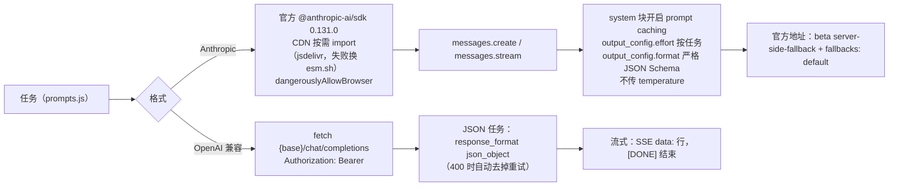
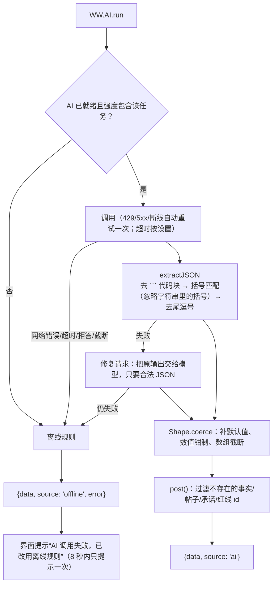

# AI 接入（AI）

游戏里 AI 负责“写”和“判”：补全公文、评审打分、按自然语言条件筛帖、按节奏方向写水军评论、生成每回合的网评与热搜、写客户巨信、判断举报是否属实、写结案报告，以及在编辑器里一句话生成关卡。**所有数值都由引擎计算**——AI 的打分有上下限、会被钳制，AI 不可用时每个任务都有离线规则兜底，游戏照样能完整玩下去。

---

## 1. 配置

在游戏或编辑器里点「AI 设置」：

| 设置 | 说明 |
|---|---|
| 服务商 | 预设会自动填好接口地址和常用模型，也可以选“自定义” |
| 模型 | Claude 默认 `claude-opus-5-5`；想更快更省可以选 `claude-sonnet-5-5` 或 `claude-haiku-5-5` |
| 接口地址 | Base URL |
| API Key | 只保存在你的浏览器里；可选“仅本次会话”（关闭标签页即清除） |
| AI 强度 | **完整**：全部任务用 AI；**精简**：只有公文补全/润色/评审、回合网评、铁拳判定、结案报告用 AI，其余走离线规则（更省）；**离线**：不调用 AI |
| 结构化输出 | Anthropic 格式专用，用 `output_config.format` 强制 JSON；中转不支持时会自动降级 |
| 拒答时服务端自动回退 | Anthropic 官方地址专用，默认开启 |
| JSON 模式 / Temperature | OpenAI 兼容格式专用 |
| 公文补全流式输出 | 逐字显示 |
| 本地代理 | 见第 3 节 |

「测试连接」会发一个极小的请求验证配置；「AI 调用日志」能看到每次调用的提示词、原始返回、耗时和 token 用量（不记录 Key），方便关卡作者调提示词。

### 服务商预设

| 预设 | 格式 | 接口地址 | 示例模型 |
|---|---|---|---|
| Claude（Anthropic 官方） | Anthropic | `https://api.anthropic.com` | `claude-opus-5-5` / `claude-sonnet-5-5` / `claude-haiku-5-5` |
| Claude（Anthropic 格式中转） | Anthropic | 中转服务商提供 | 同上 |
| DeepSeek | OpenAI 兼容 | `https://api.deepseek.com` | `deepseek-chat` |
| 通义千问（阿里云百炼） | OpenAI 兼容 | `https://dashscope.aliyuncs.com/compatible-mode/v1` | `qwen-plus` |
| Kimi（月之暗面） | OpenAI 兼容 | `https://api.moonshot.cn/v1` | `moonshot-v1-32k` |
| 智谱 GLM | OpenAI 兼容 | `https://open.bigmodel.cn/api/paas/v4` | `glm-4-plus` |
| 豆包（火山方舟） | OpenAI 兼容 | `https://ark.cn-beijing.volces.com/api/v3` | 填推理接入点 ID |
| 硅基流动 | OpenAI 兼容 | `https://api.siliconflow.cn/v1` | `deepseek-ai/DeepSeek-V3` |
| OpenRouter | OpenAI 兼容 | `https://openrouter.ai/api/v1` | `deepseek/deepseek-chat` |
| 本地 Ollama | OpenAI 兼容 | `http://localhost:11434/v1` | `qwen2.5:14b`（无需 Key） |

---

## 2. 两种适配器



- **Anthropic**：浏览器直连需要的 `anthropic-dangerous-direct-browser-access` 头由 SDK 自动加上。按任务设置 `effort`：筛帖、网评、水军、控评、软文、自定义道具等用 `low`；公文补全/润色/评审、铁拳判定、结案报告、编辑器分区补全用 `medium`；编辑器一句话生成关卡用 `high`。`stop_reason` 为 `refusal` 或 JSON 任务被 `max_tokens` 截断时视为失败，回退离线。如果中转服务不认 `output_config`/`effort`/`fallbacks` 等参数（返回 400），会自动切换到兼容模式重发。
- **OpenAI 兼容**：系统提示词末尾会附上 JSON 结构说明（因为这类接口不强制结构）；`max_tokens` 上限 8000。

---

## 3. 跨域与本地代理

浏览器里直接调用接口要求服务商允许跨域（CORS）。如果你的服务商不允许，用项目自带的本地代理：

```bash
python tools/serve.py
```

然后打开 `http://127.0.0.1:8765/Start.html`，在「AI 设置」里勾选“通过本地代理转发请求”。请求会变成：

```text
http://127.0.0.1:8765/llm-proxy/<base64url(接口地址)>/chat/completions
```

代理原样转发请求头和请求体，并把响应（包括流式 SSE）原样传回。它只监听 `127.0.0.1`，只接受同源页面或 `file://` 页面的请求（其他网站来源一律 403），上游只允许 http/https。

---

## 4. 提示词与 JSON 协议

系统提示词（`WW.AI.baseSystem`）在一整关里保持不变，因此能被服务商缓存。它包含：虚构讽刺游戏的设定与硬性规则（不出现真实人物/品牌/机构/媒体，不涉及现实政治，监管写作“有关部门/平台”，境外写作“外网/海外媒体”，允许网络梗但不许仇恨与色情）、委托方与事件、平台与阵营、网民画像、**事实与隐藏真相**、客户红线、对手、关卡的文风补充、当前难度的“网友敏锐度”。规则还要求：真相只用于判断，替网民写内容时不能剧透尚未曝光的真相。

每个任务的 user 提示词带上当前局势（回合、阶段、五个数值、网民已知的信息、新出现的事实、最近的官方表态、近期热帖），再加任务要求。

| 任务 | 何时 | 输出结构（要点） | 离线规则 |
|---|---|---|---|
| `feed.generate` | 结束回合 | `posts[{slot, author, title, content, comments[]}]`、`headlines[]`、`summary`、`client` | 按立场取文本池；有 hint 时套模板 |
| `statement.complete` | 公文 AI 补全 | 纯文本（可流式） | 按公文类型骨架 + 语气短语拼接 |
| `statement.polish` | 公文润色 | 纯文本 | 替换套话、按语气补一句 |
| `statement.judge` | 发布公文 | `scores{8 项 0-10}`、`denies[]`、`admits[]`、`promises[{text,days}]`、`fulfills[]`、`violations[]`、`reactions[]`、`verdict` | 关键词词典打分；按句子把否认/承认归到最匹配的事实；正则识别“X 日内公布” |
| `posts.classify` | 删帖 / 限流筛选 | `matches[{id, reason}]` | 中文切词（二字、三字滑窗）+ 负面/苦主/大V/谣言/水军/截图/外网等规则 |
| `shill.generate` | 水军 | `posts[{author, content}]`、`persuasiveness`、`awkwardness` | 按档次取模板；按方向长度与措辞估说服力和违和感 |
| `control.generate` | 控评 | `comments[]` | 好评模板 |
| `kol.write` | KOL 软文 | `author`、`title`、`content`、`persuasiveness` | 模板 + brief |
| `distraction.generate` | 买热搜 | `topic`、`posts[]` | 话题池 |
| `expose.generate` | 反向扒皮 | `posts[]` | 扒皮模板 |
| `report.judge` | 召唤铁拳（目标帖未关联事实时） | `violation`、`type`、`confidence`、`reason` | 隐私/辱骂/传言关键词 |
| `item.custom` | 自定义 AI 道具 | `narration`、`deltas{5 个数值}`、`posts[]` | 关卡给的固定数值或范围的 60% 位置 |
| `ending.report` | 结案 | `report`、`epilogue` | 统计数据拼报告 + 评级尾声 |
| `level.generate` / `level.fill` | 编辑器 | 完整关卡 JSON / 追加的列表项 | 不可用（需要配置 AI） |

**引擎掌控数值**：`feed.generate` 的“发帖位”已经由引擎决定好平台、作者层级、阵营和立场（立场分布来自各阵营当前好感），AI 只填写内容，所以网评永远和数值一致；公文评审的分数也只是输入，好感和热度的变化由引擎公式换算。

---

## 5. 健壮性



所有 AI 文本都以纯文本节点渲染，不会被当作 HTML 执行。

---

## 6. 成本参考

一局 8 回合、每回合 3 个行动的典型调用量（完整强度）：每回合 1 次网评 + 1~3 次道具/公文相关调用，整局约 20~40 次；每次输入约 3~6K token（系统提示词可被缓存）、输出 0.5~3K token。想省钱可以：

- 选更小的模型（如 `claude-haiku-5-5`、`deepseek-chat`）；
- 把「AI 强度」调成**精简**，只让最影响体验的任务走 AI；
- 用「AI 调用日志」查看每次调用的实际 token 用量。

---

## 7. 隐私

- API Key 只保存在本机浏览器（localStorage 或 sessionStorage），只发送到你填写的接口地址；
- 「AI 调用日志」不记录 Key；
- 游戏内容（关卡设定、局势、你写的公文）会发送给你配置的模型服务。
