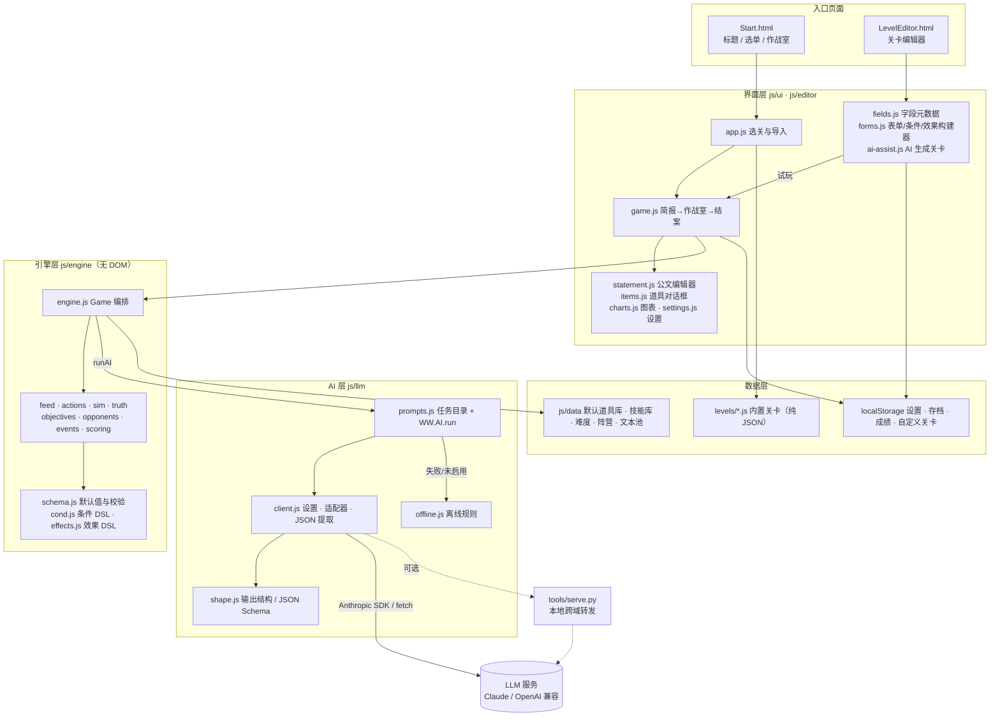
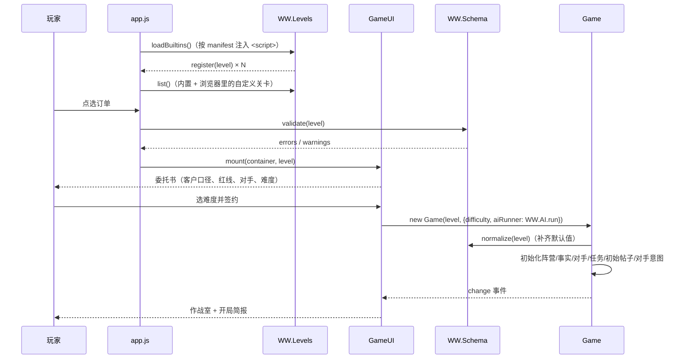
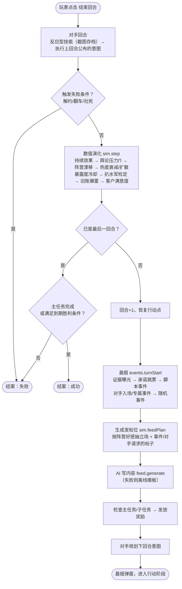
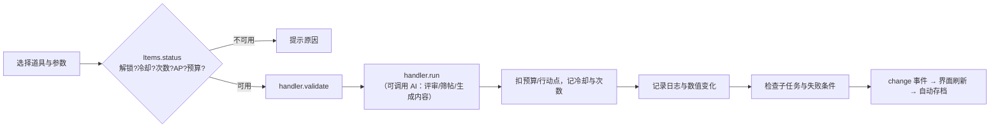
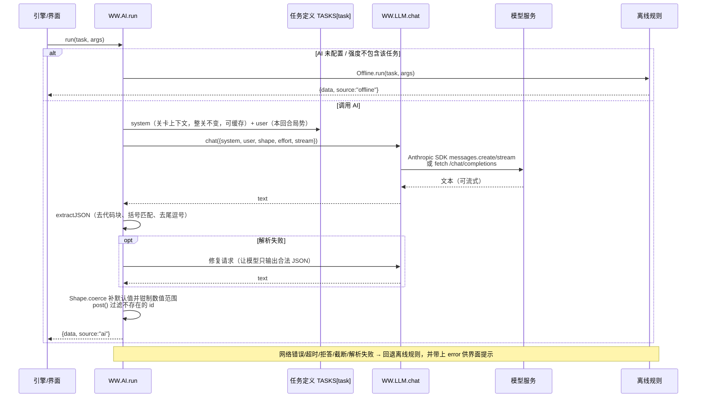
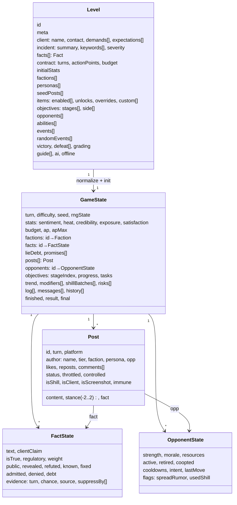
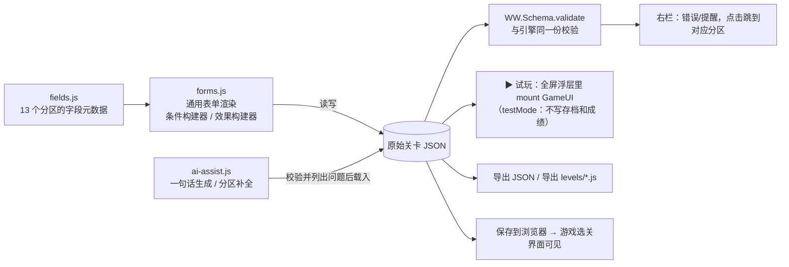

# 框架说明（Architecture）

《公关洗地模拟器》是一个纯静态的 HTML/JS 游戏：没有构建步骤、没有 npm 依赖，双击 `Start.html` 就能玩，也可以用 `python tools/serve.py` 起本地服务。整体遵循三条原则：

1. **关卡与引擎分离**：关卡是纯 JSON 数据，引擎只认 schema；新增关卡不需要改任何代码。
2. **数值由引擎算，AI 只写内容和有界打分**：AI 输出一律是 JSON，经结构校验和数值钳制后才交给引擎换算；任何 AI 失败都自动回退离线规则。
3. **引擎不碰 DOM**：同一套引擎既跑在浏览器里，也能在 Node 里做单元测试和自动平衡模拟；游戏界面可以挂载到任意容器，编辑器的“试玩”直接复用它。

---

## 1. 分层架构



所有脚本都是经典 `<script>`（不是 ES module），挂在全局命名空间 `window.WW` 上——因为浏览器在 `file://` 下会拦截本地 module 的加载。加载顺序见 `Start.html`：core → data → engine → llm → ui → `levels/manifest.js`。

---

## 2. 目录与模块职责

| 路径 | 职责 |
|---|---|
| `Start.html` | 游戏入口，加载全部脚本 |
| `LevelEditor.html` | 关卡编辑器入口 |
| `js/core/` | `ns.js` 命名空间 · `log.js` 异常日志 · `util.js` 种子随机数/格式化/深合并 · `bus.js` 事件总线 · `storage.js` 带兜底的本地存储 |
| `js/data/` | 默认数据：`platforms` 平台与作者层级 · `factions` 阵营与“作用渠道” · `personas` 网民画像 · `pools` 离线文本池 · `statements` 公文类型 · `items` 道具库 · `abilities` 对手技能库 · `difficulty` 难度表 |
| `js/engine/schema.js` | 关卡默认值、`normalize()` 补全、`validate()` 校验（编辑器与引擎共用） |
| `js/engine/cond.js` · `effects.js` | 条件 DSL 与效果 DSL：求值、中文描述、校验 |
| `js/engine/feed.js` | 帖子模型、作者生成、舆论压力 Π |
| `js/engine/items.js` · `actions.js` | 道具解析与可用性；18 种道具的效果实现 |
| `js/engine/truth.js` | 否认/承认、证据曝光、打脸、辟谣、承诺跳票、监管“铁拳” |
| `js/engine/sim.js` | 回合演化：阵营漂移、热度衰减、扒水军、旧账爆雷、客户满意度；生成“发帖位” |
| `js/engine/objectives.js` | 主任务阶段 / 子任务 / 支线 |
| `js/engine/guide.js` | 教程引导：按条件推进步骤、当前步骤、帖子选择器（UI 的教程卡片与测试共用） |
| `js/engine/opponents.js` | 对手盘：选招、意图、技能效果、专属事件 |
| `js/engine/events.js` | 回合开局：证据、承诺、脚本事件、随机事件 |
| `js/engine/scoring.js` | 结案评分与评级 |
| `js/engine/engine.js` | `Game` 类：状态、帮助函数、`act()` / `endTurn()` / 存档 |
| `js/engine/levels.js` | 关卡注册表、动态加载内置关卡、导入解析、导出脚本 |
| `js/engine/bots.js` | 离线机器人：固定打法（平衡表用）、照教程卡片操作、参数化打法 `policy(genome)`（编辑器通关测试和 Node 测试共用） |
| `js/llm/` | AI 设置与适配器（`client.js`）、任务提示词与运行器（`prompts.js`）、输出结构（`shape.js`）、离线规则（`offline.js`） |
| `js/ui/` | 界面：`app.js` 选关 · `game.js` 作战室 · `runs.js` 存档（档案馆、对局记录、写成爽文） · `statement.js` 公文编辑器 · `items.js` 道具对话框 · `charts.js` 图表 · `settings.js` 设置 · `dom.js` 安全的 DOM 工具 |
| `js/editor/` | 编辑器：`fields.js` 字段元数据 · `forms.js` 表单渲染 · `editor.js` 主程序 · `levelgen.js` 分段生成关卡（无 DOM，评测也用）· `ai-assist.js` AI 生成弹窗与分区补全 · `levelcheck.js` 通关测试的扫描与体检分析（无 DOM，`--check` 也用）· `levelcheck-ui.js` 通关测试弹窗 |
| `levels/` | `manifest.js` 内置关卡清单 + 每关一个文件 |
| `tools/serve.py` | 可选的本地静态服务 + LLM 跨域转发 + API Key 托管（`/api/key`） |
| `tools/keystore.py` | Key 托管的存储：环境变量 / Windows DPAPI / Linux `secret-tool` / 0600 文件 |
| `tests/run.js` | Node 测试：单元测试 + 自动平衡模拟 + `--check` 通关测试 |

---

## 3. 关卡加载与开局



内置关卡文件内容只有一行 `WW.Levels.register({ ...纯 JSON... })`，这样 `file://` 下也能加载；自定义关卡只以 JSON 形式导入或存进浏览器，**从不执行关卡里的代码**。

---

## 4. 回合引擎主循环

`game.endTurn()` 是整个模拟的心脏。顺序很重要：对手先出招，再做数值演化，然后进入下一回合的“晨报”，最后才让 AI 按**已经算好的数值**写内容。



玩家的每一次行动走 `game.act(itemId, params)`：



---

## 5. AI 调用管线

所有 AI 调用都经过 `WW.AI.run(game, task, args)`，它**永远会返回结果**：



两种适配器：

| 适配器 | 用于 | 要点 |
|---|---|---|
| Anthropic | Claude 官方 / Anthropic 格式中转 | 官方 `@anthropic-ai/sdk`（CDN 按需 `import()`，钉死 0.131.0，`dangerouslyAllowBrowser`）；`output_config.effort` 按任务设定；JSON 任务用 `output_config.format`（严格 JSON Schema）；system 块开启 prompt caching；官方地址默认开启服务端拒答回退；中转不认这些参数时自动降级重试 |
| OpenAI 兼容 | DeepSeek、通义、Kimi、智谱、豆包、硅基流动、OpenRouter、Ollama…… | `POST {base}/chat/completions`；JSON 任务带 `response_format`（LM Studio 等支持 schema 的先用 `json_schema`，其余先用 `json_object` 再试 `json_schema`；400 时换下一种，最后不带，并按接口地址 + 模型记住可用的那一种）；SSE 流式解析 |

详细的任务清单与 JSON 协议见 [AI.md](AI.md)。

---

## 6. 数据模型



`GameState` 是可序列化的纯数据（随机数状态也在里面），存档就是 `JSON.stringify(state)`；同一个种子 + 同样的操作必然得到同样的结果（离线模式下）。

---

## 7. 关卡编辑器如何复用引擎



---

## 8. 存储、存档与安全

| 键（localStorage，前缀 `ww.`） | 内容 |
|---|---|
| `settings` | AI 设置（不含 Key；托管模式下只有 `serverKeyOrigin` 和掩码 `serverKeyHint`） |
| `apikey` / sessionStorage `apikey` | API Key（仅“保存在本浏览器”/“仅本次会话”模式；切到托管模式时删除） |
| `runs` | 存档索引：每局一条（关卡、难度、回合、是否结案、评级、⭐、是否已成文、时间） |
| `run.<存档id>` | 一局的完整存档（`Game.serialize()`）+ `ending`（结案报告）+ `story`（爽文）。每次签约开局新建一份；结案后保留为战绩，帖子只留最热 30 条。已结案的局最多 30 份，超出或写入时空间不足，自动删最旧的未加星战绩（进行中的局从不自动删）。旧版的 `save.<关卡id>` 首次读取时迁移过来 |
| `records` | 每关 × 每难度的最佳成绩 |
| `customLevels` | 编辑器保存或导入的关卡 |
| `editorDraft` | 编辑器草稿 |
| `theme` | 界面主题 |
| `errorLog` | 异常日志：最近 100 条错误和警告（`js/core/log.js`，写入前脱敏，不含 Key） |

- 异常日志：`js/core/log.js` 紧跟 `ns.js` 加载，不依赖 DOM。它负责三件事：
  - 监听 `error`（含资源加载失败）和 `unhandledrejection`，并镜像 `console.error/warn`；
  - 引擎、事件总线、AI 调用、关卡生成、红色 toast 都通过 `WW.Log.error/warn/info(source, msg, detail)` 写入；
  - 连续相同的记录合并计数，内存最多保留 300 条；warn/error 持久化到 `errorLog`。

  `js/ui/logview.js` 是查看面板，入口是 🐞 按钮和 `Ctrl+Shift+L`。
- 帖子、关卡文本、AI 输出全部以 `textContent` / 文本节点渲染，没有 `innerHTML`，防止 XSS。
- 自定义关卡只解析 JSON，不执行代码。
- API Key 默认由 `tools/serve.py` 托管（`tools/keystore.py`：环境变量 / Windows DPAPI / Linux `secret-tool` / 0600 文件），浏览器只留掩码；Key 绑定接口地址的源，代理只把它注入发往该源的请求，且不跟随重定向。选择浏览器保存时存在 localStorage / sessionStorage。无论哪种方式，Key 都只发给你填写的接口地址；AI 调用日志不记录 Key。
- `tools/serve.py` 只监听 `127.0.0.1`，校验 Host 头（只认 `127.0.0.1:<端口>` / `localhost:<端口>`）；转发和 `/api/key` 只接受 POST，且 Origin 必须是本服务页面（`/api/key` 还要求 `Content-Type: application/json`），`file://` 页面和沙箱 iframe（`Origin: null`）及其他网站一律 403；以 `.` 开头的路径不对外提供；上游只允许 http/https。

---

## 9. 测试与平衡

```bash
node tests/run.js
```

- 单元测试：随机数确定性、模板、深合并、条件 DSL、schema 补全与校验、离线评审、离线分词、存档恢复、输出结构转 JSON Schema、JSON 提取容错，以及**所有内置关卡零校验错误**。
- 平衡模拟：用 6 种机器人策略（摆烂 / 全水军 / 真诚 / 平衡 / 高手 / 随机）在每关每档难度各跑若干局，统计胜率、平均分、评级分布和失败原因。`--balance 50 --diffs all` 跑完整报告，`--trace smart --level milktea` 打印单局逐回合数值。
- 通关测试：`node tests/run.js --check <关卡 id 或 .json 文件> [--depth quick|standard|deep] [--intent any|admit|cover]`，和编辑器里的「🧪 通关测试」是同一套扫描与判定（见 [Gameplay.md](Gameplay.md#14-通关测试关卡合理性体检)），有红色结论时退出码为 2。结果见 [Gameplay.md](Gameplay.md#13-难度曲线与平衡数据)。
