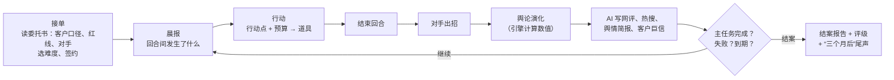
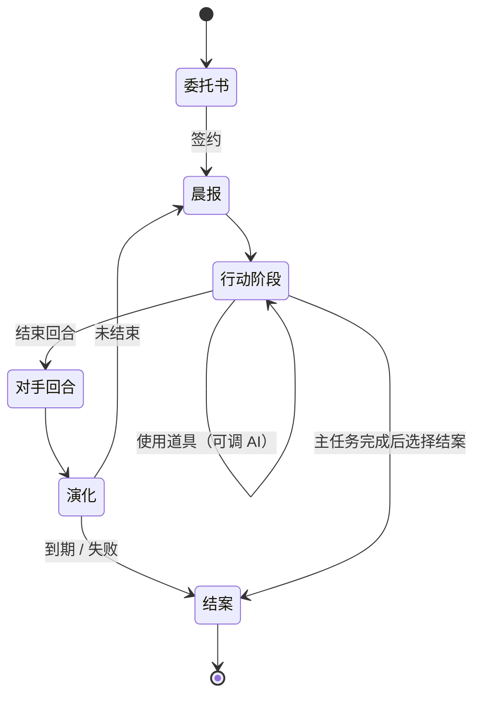
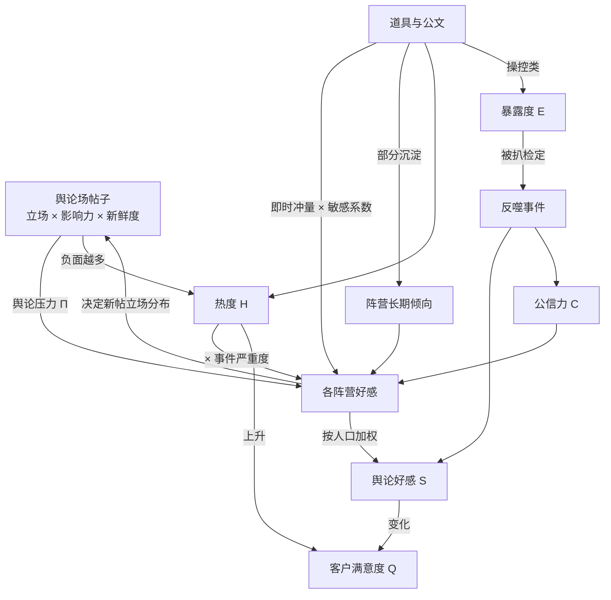
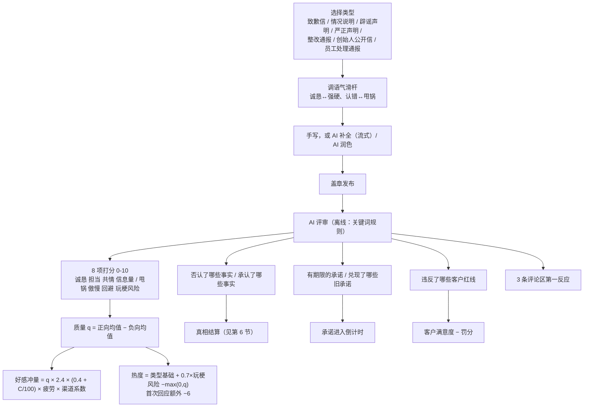
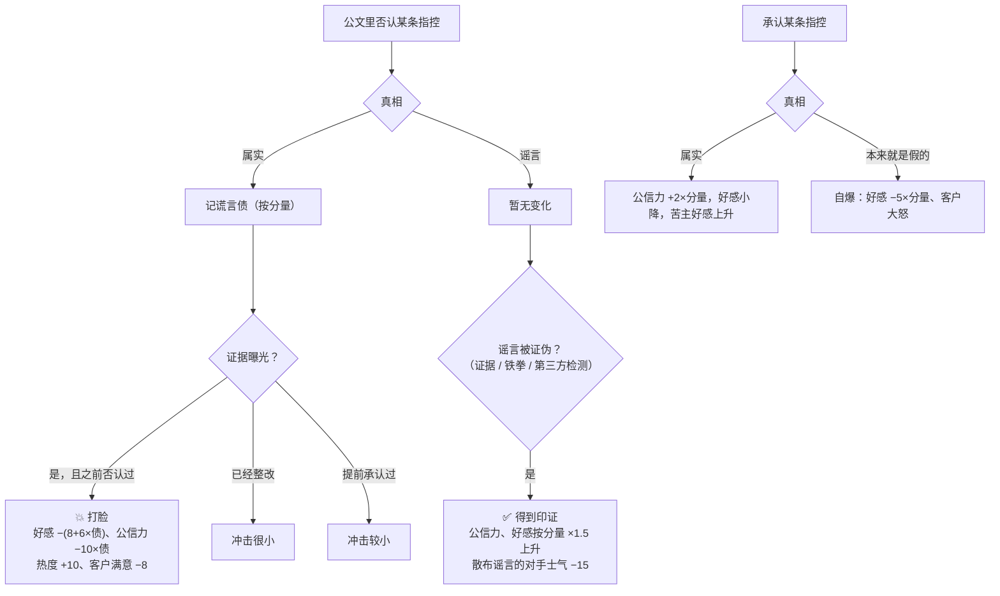
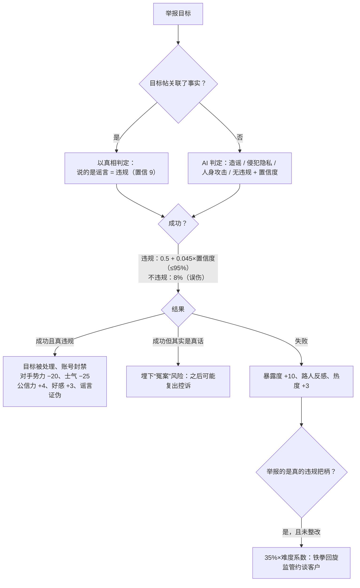
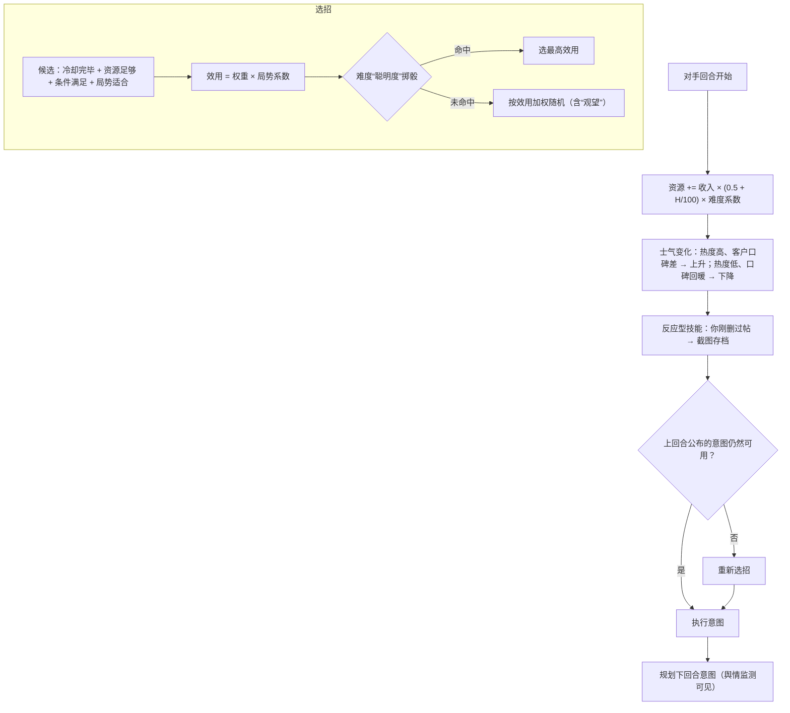
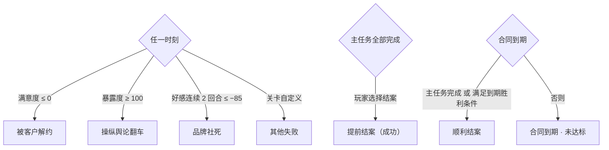

# 玩法机制（Gameplay）

你经营一家危机公关公司「白净危机公关」。每一关是一单委托：客户出了事，给你一笔预算和若干回合，你要在合同期内把舆论“洗”回来——用公文、控评、删帖、水军、召唤铁拳……或者偶尔，说真话。

本文所有数字都来自代码（`js/engine/*`、`js/data/*`），关卡可以通过 `tuning` 和覆盖字段调整。

---

## 1. 核心循环

一关 5–10 个回合，每回合按“第 N 天 白天/深夜”推进。每回合有行动点（默认 3），道具消耗行动点和预算。

---

## 2. 五个数值

| 数值 | 范围 | 作用 | 归零/封顶 |
|---|---|---|---|
| 舆论好感 S | −100~100 | 各阵营好感按人口加权，核心 KPI | 连续 2 回合 ≤ −85 → **品牌社死** |
| 事件热度 H | 0~100 | 越热，负面越容易发酵、水军越难起效；决定舆情阶段与热搜排名 | — |
| 公信力 C | 0~100 | 公文效果的乘数，也拉动阵营的长期倾向 | — |
| 暴露度 E | 0~100 | 网友对“有人在操控”的怀疑，越高越容易被扒 | 满 100 → **操纵舆论翻车** |
| 客户满意度 Q | 0~100 | 客户对你的信任 | 归零 → **被客户解约** |

另有预算 B（万元）与行动点 AP。未部署「舆情监测」时，暴露度只显示大致档位，阵营只显示倾向词，对手意图只显示“？？？（类别）”。

### 回合演化公式（`sim.js`）

| 步骤 | 公式（默认参数） |
|---|---|
| 舆论压力 | Π = Σ(立场 × 影响力 × 0.65^帖龄 × 处置系数) ÷ (Σ(影响力 × 0.65^帖龄) + 20)，范围 −2~2；官方帖和已删帖不计；限流 ×0.4，控评后的负面帖 ×0.5 |
| 影响力 | 作者层级（素人 1 / KOL 5 / 大V 12 / 媒体 20 / 官媒 40）× 平台系数（围脖 1.2、颤音 1.3、新闻 1.5……） |
| 阵营漂移 | 目标 = 长期倾向 + 16·Π + 0.3·(C−50) − 严重度·0.25·H/100；好感 += 波动性 ×（目标 − 好感） |
| 热度 | H′ = H·(1 − 0.2) + max(0, −Π)·4·H/100（各关可调衰减率） |
| 暴露度冷却 | 本回合没有操控行为时 −4 |
| 扒水军检定 | p = 0.6 × 该批水军识别度 × (0.25 + E/100) × 难度识别系数 × (0.6 + 4×扒皮党占比) × 0.35，上限 85% |
| 客户满意度 | ΔQ = 0.25·ΔS − 0.25·热度上升量 −（H≥70 时 2）−（单回合花掉初始预算 40% 以上时 4）；扣分 ÷ 客户耐心系数 |

### 冲量与沉淀

每个行动都有一个“作用渠道”（公文、道歉、水军、KOL、律师函、删帖、赔偿、转移话题、强硬定性、反向扒皮、整改、甩锅、事件冲击）。冲量乘以**阵营对该渠道的敏感系数**后加到阵营好感上，同时按渠道的沉淀比例写进阵营的长期倾向：

| 渠道 | 沉淀比例 | 说明 |
|---|---|---|
| 真诚整改 | 0.8 | 改了就是改了，长期有效 |
| 赔偿和解 | 0.6 | |
| 道歉认错 | 0.4 | |
| 公文表态 / 删帖限流 / 事件冲击 / 反向扒皮 | 0.3 | |
| 律师函 / KOL / 强硬定性 | 0.2~0.25 | |
| 甩锅 | 0.1 | |
| 水军控评 | 0.05 | 热闹一阵就散 |
| 转移话题 | 0 | 只是挪走注意力 |

所以水军和转移话题只能“续命”，真正把口碑拉回来要靠整改、道歉、赔偿和公信力。

---

## 3. 受众阵营

默认 6 个阵营（关卡可以改名、改比例、改系数）：

| 阵营 | 占比 | 特点 | 关键敏感系数 |
|---|---|---|---|
| 吃瓜路人 | 42% | 人数最多，容易被带节奏，也最容易忘 | 转移话题 1.2、KOL 1.2、律师函 −0.6 |
| 品牌粉丝 | 16% | 天然护主，爱看强硬表态 | 公文 1.3、强硬定性 1.2、反向扒皮 1.2 |
| 苦主 | 8% | 只认道歉与赔偿 | 赔偿 2.0、整改 1.5、律师函 −1.5、删帖 −1.2 |
| 扒皮党 | 12% | 爱整理时间线，水军与删帖的天敌 | 水军 −0.8、删帖 −1.0、甩锅 −0.6 |
| 媒体大V | 12% | 要信息要立场，讨厌被删稿 | 删帖 −0.9、强硬定性 −0.6 |
| 对家 | 10% | 基本不可能转化，但能被打击 | 反向扒皮 0.6 |

负系数意味着反噬：同一批水军让路人好感上升，却让扒皮党更反感。

---

## 4. 道具图鉴

道具分三层，随主任务阶段解锁（关卡也可以单独写解锁条件）。

| 层级 | 道具 | AP / 价格 | AI 参与 | 效果 | 风险 |
|---|---|---|---|---|---|
| 基础 | 📜 发布公文 | 1 / 1万 | 补全、润色、评审打分 | 按评审换算好感、热度、公信力 | 谎言债、红线、玩梗，同回合连发递减 |
| 基础 | 🦆 水军 | 1 / 0.6~4.5 万每百条 | 按“节奏方向”写样例帖，评估说服力与违和感 | 好感冲量（热度越高越弱） | 暴露度；被扒时冲量 ×1.6 反向返还 |
| 基础 | 🗑️ 删帖 | 1 / 按帖计价 | 按一句话条件筛帖，预览确认 | 移除负面、降热度、推迟可压制的证据 | 大V/媒体贵、官媒和外网删不掉；删帖反噬、截图存档 |
| 基础 | 🛡️ 控评 | 1 / 3万+ | 写热评 | 负面帖：影响减半；任意帖：折叠差评、好评上热评，2 回合内护住不被抱团举报。可以控自家的官方公文、软文、水军帖（官方帖只能控评，不能删帖、限流、发律师函或举报） | 暴露度 |
| 进阶 | 📉 撤热搜 | 1 / 15万 | — | 热度 −25 | 热度 ≥70 时 35% 概率“心虚”反噬，并刺激对手去外网 |
| 进阶 | 🔇 限流降权 | 1 / 删帖价 ×1.5 | 筛帖 | 影响力 ×0.4，更隐蔽 | 外网限不了 |
| 进阶 | 🍉 买热搜转移话题 | 1 / 12万 | 编一个更大的瓜 | 热度 −12，下回合再 −8 | 重复使用会被识破 |
| 进阶 | ✍️ KOL 软文 | 1 / 5~40 万 | 代写软文并评估说服力 | 路人/媒体好感上升，公信力微升 | 恰饭被扒 |
| 进阶 | ⚖️ 律师函 | 1 / 3万 | — | 震慑大V/对手，可能让对方删帖、压制证据 | 路人反感；发给苦主 = 灾难 |
| 进阶 | 👊 召唤铁拳 | 1 / 5万，冷却 2，限 2 次 | 判定目标是否真违规 | 见第 7 节 | 举报说真话 → 失败，可能铁拳回旋 |
| 进阶 | 🔍 反向扒皮 | 1 / 6万（需舆情监测） | 写扒皮帖 | 对手士气 −30、势力 −10、好感上升 | 对手没把柄就被嘲 |
| 进阶 | 📡 舆情监测 | 1 / 10万，全程生效 | — | 显示精确暴露度、阵营明细、对手意图、证据预警、谎言债 | — |
| 高阶 | 🕵️ 内部摸底调查 | 1 / 8万 | — | 揭示某条“客户口径”是否属实、证据何时可能曝光 | — |
| 高阶 | 🤝 私下和解赔偿 | 1 / 10~50 万 | — | 苦主好感大升、撤下维权帖、压制苦主证据 | 封口协议泄露 |
| 高阶 | 💰 招安收编 | 1 / 按对手势力 | — | 75% 让对手退场 | 受害者群体收买不了；交易泄露 |
| 高阶 | 🙇 临时工背锅 | 1 / 2万 | — | 快速止血 | 公信力 −6；再用就是“又是临时工”；真相指向管理层时记谎言债 |
| 高阶 | 🧪 第三方检测背书 | 1 / 15万 | — | 证伪一条指控：真是谣言则公信力 +12 | 指控其实是真的 → 定时炸弹，曝光时打脸 ×1.5 |
| 高阶 | 🔧 真诚整改 | 2 / 初始预算的 30% | — | 3 回合持续回暖，所有真事实标记“已整改”（堵住铁拳把柄、打脸减半） | 很贵，客户可能大怒 |
| 关卡定制 | ✨ 自定义 AI 道具 | 关卡设定 | 关卡写规则提示词 | AI 在设定的上下限内返回数值和帖子 | 关卡设定 |

---

## 5. 公文系统

疲劳：同回合第 n 篇 ×0.6^(n−1)，整关累计每多一篇 −7%（最低一半）。

---

## 6. 真相、谎言债与打脸

每条事实都有“客户口径”和隐藏真相。客户可能骗你——「内部摸底调查」能查清。

- **证据时间线**：事实可设置“最早曝光回合 + 每回合概率 + 来源”，未曝光时概率每回合 +25%。删帖/和解/律师函能把可压制的证据推迟（最多 3 回合），大额和解可以直接压住。
- **承诺**：公文里的“X 日内公布结果”会变成倒计时；到期前发一篇“情况说明/整改通报”兑现，否则“跳票”：公信力 −8、好感 −5、热度 +5。
- **旧账爆雷**：和解、招安、KOL、假检测报告、冤枉了说真话的人——这些操作会留下“风险”，之后每回合都可能爆雷。

---

## 7. 召唤铁拳（双方对称）

铁拳只砸真违规。谁召唤都一样：看真相。

**对手也会召唤铁拳**：只有当客户的“违规把柄”（标记 `regulatory` 的真事实）已经被证据曝光时，正规对手才会出手，成功率 75% × 势力系数。成功即“监管约谈”：好感 −12、公信力 −10、客户满意 −12、热度 +8，并封锁 KOL/转移话题/水军/撤热搜 2 回合。鲁莽的对手（比如对家粉丝）会在没有实据时乱举报——那就是“诬告翻车”：对手士气 −25、势力 −10，客户公信力 +4。

最好的防守：在证据曝光前**真诚整改**，把把柄变成“已整改”。

---

## 8. 主任务与子任务

- **推进度** = 已完成必做子任务 ÷ 必做子任务总数，显示在顶栏。
- 子任务可以有截止回合、失败条件、隐藏（完成才显示），也可以设为“结案时判定”（比如“零水军通关”）。
- 奖励可以是：追加预算、解锁道具、+行动点、一次性免费券、削弱对手、评分加成。失败也可以带惩罚。
- 主任务完成后可以立刻结案（每剩 1 回合 +3 分，最多 +12），也可以继续经营冲更高评级。

---

## 9. 对手盘

每关 1~3 个对手。属性：**势力**（招式力度，力度系数 = 势力/50 × 难度系数）、**士气**（归零即偃旗息鼓）、**资源**（出招消耗，每回合按热度增长）。

### 经典技能库

| 技能 | 什么时候爱用 | 效果 | 怎么应对 |
|---|---|---|---|
| 🚩 抱团举报 | 你最近发了公文、软文或水军 | 按比例下架这些内容（水军 60%、软文 35%、官方 15%），封号抬高暴露度；没有可举报内容时让官方号被限流一回合 | 精品水军、先控评护住、对其召唤铁拳 |
| 🌐 告洋状 | 热度 ≥45，且你删过帖或撤过热搜 | 外网帖删不掉也限不了流，热度上升、公信力下降；但“告洋状”也让对手自身势力 −8、粉丝反而抱团 | 冷处理、发澄清公文；越压越容易逼它出手 |
| 🧲 吃黑流量 | 热度 ≥40，越热越爱用 | 营销号批量产黑稿，热度上升，还能赚回资源 | 把热度降下来断它的流量；律师函、限流，对造谣黑稿召唤铁拳 |
| 👊 召唤铁拳 | 握有已曝光的违规把柄 | 监管约谈（见第 7 节）；无实据则诬告翻车 | 证据曝光前真诚整改 |
| 📼 翻旧账 | 第 3 回合以后 | 挖出客户黑历史（新增事实，真的立即实锤） | 预先摸底、KOL 先定调 |
| 🗯️ 造谣带节奏 | 随时 | 制造一条新谣言（假事实）并大量转发 | 辟谣（真相站在你这边时公信力会涨）、召唤铁拳 |
| 📸 截图存档 | 你刚删过帖（反应型，不占意图） | 被删内容以截图形式重新流传，暴露度上升 | 少删多限流 |
| 🐟 买水军反打 | 对家品牌专属 | 一批抹黑水军——这也是它的把柄 | 舆情监测识破 → 反向扒皮 |

关卡还可以给对手配**专属事件**（例如“前助理开直播哭诉”），以及用效果列表实现的**专属技能**。

---

## 10. 难度

| 档位 | 预算 | 行动点 | 暴露增长 | 被扒/泄露概率 | 对手力度 | 对手聪明度 | 客户耐心 | 开局修正 | 网友敏锐度（写进 AI 提示词） |
|---|---|---|---|---|---|---|---|---|---|
| 🐣 实习生 | ×1.3 | +1 | ×0.7 | ×0.6 | ×0.6 | 0 | ×1.4 | 好感 +8、热度 −5 | 好糊弄 |
| 💼 正式工 | ×1 | 0 | ×1 | ×1 | ×1 | 0.3 | ×1 | — | 正常 |
| 🏅 金牌公关 | ×0.85 | 0 | ×1.25 | ×1.3 | ×1.3 | 0.6 | ×0.8 | 好感 −3 | 爱较真 |
| 🔥 地狱 | ×0.75 | 0 | ×1.4 | ×1.5 | ×1.5 | 1（必选最优招） | ×0.7 | 好感 −6、热度 +5 | 人均福尔摩斯 |

关卡可以覆盖任意档位的参数，或只开放部分档位；成绩按“关卡 × 难度”分别记录。

---

## 11. 胜负与评级

**结案评分**（0~100）：

| 组成 | 换算 | 默认权重 |
|---|---|---|
| 舆论好感 | (S + 100) / 2 | 35% |
| 热度控制 | 100 − H | 15% |
| 公信力 | C | 15% |
| 客户满意 | Q | 15% |
| 预算结余 | 结余 / 初始预算 × 150（封顶 100） | 10% |
| 隐蔽程度 | 100 − E | 10% |

总分 = 加权分 ×（主任务完成 ? 1 : 0.55 + 0.45 × 推进度）+ 加分（每个完成的可选/支线子任务 +3、`score` 效果、提前结案）。失败时最高 40 分。评级线：S ≥ 85、A ≥ 72、B ≥ 60、C ≥ 45，其余 D。结案时 AI 写一份《结案报告》和一段“三个月后……”的尾声（离线时用模板）。

---

## 12. 内置关卡

| 关卡 | 难度 | 规模 | 核心考验 |
|---|---|---|---|
| 🦞 小龙虾店卫生风波（教程） | ★ | 5 回合 · 35 万 | 分步引导；“死虾”是谣言，用铁拳证伪；后厨脏是真的，早整改早安心 |
| 🧋 过期原料风波 | ★★ | 8 回合 · 80 万 | 客户红线不许承认食品安全问题，可证据第 3 回合就来；对家握着真把柄等着召唤铁拳 |
| 🎤 顶流人设崩塌 | ★★★ | 8 回合 · 120 万 | 真假混杂：耍大牌是真、霸凌是假、恋爱是真；粉丝是资产也是负债；对家粉丝会乱举报 |
| 🚗 智驾刹车门 | ★★★★ | 10 回合 · 300 万 | 扒皮党占比大，水军极易反噬；召回很贵且客户抵触，但几乎是高评级的必经之路 |

---

## 13. 难度曲线与平衡数据

`node tests/run.js --balance 20 --diffs intern,regular,gold,hell --strats idle,shill,honest,smart` 的结果（每格 20 局）。策略说明：**摆烂**什么都不做；**全水军**只用水军、删帖、控评、撤热搜、转移话题；**真诚**道歉、整改、和解、兑现承诺；**高手**知道隐藏真相（相当于查清了所有事实的熟练玩家），辟谣、铁拳打谣言、证据曝光前整改、扒对家、适度删帖与 KOL。

| 关卡 | 难度 | 摆烂 | 全水军 | 真诚 | 高手 |
|---|---|---|---|---|---|
| 教程 | 实习生 | 0% | 0% | 100% | 100%（A 为主） |
| 教程 | 正式工 | 0% | 0% | 55% | 100% |
| 教程 | 金牌 | 0% | 0% | 45% | 95% |
| 教程 | 地狱 | 0% | 0% | 35% | 35% |
| 过期原料 | 实习生 | 0% | 0% | 90% | 100%（全 S） |
| 过期原料 | 正式工 | 0% | 0% | 5% | 95% |
| 过期原料 | 金牌 | 0% | 0% | 0% | 95% |
| 过期原料 | 地狱 | 0% | 0% | 0% | 60% |
| 顶流塌房 | 实习生 | 0% | 0% | 100% | 100% |
| 顶流塌房 | 正式工 | 0% | 0% | 50% | 80% |
| 顶流塌房 | 金牌 | 0% | 0% | 0% | 15% |
| 顶流塌房 | 地狱 | 0% | 0% | 0% | 0% |
| 智驾刹车门 | 实习生 | 0% | 0% | 25% | 100% |
| 智驾刹车门 | 正式工 | 0% | 0% | 0% | 70% |
| 智驾刹车门 | 金牌 | 0% | 0% | 0% | 35% |
| 智驾刹车门 | 地狱 | 0% | 0% | 0% | 0% |

读法：

- **只洗不改必败**：全水军在所有关卡、所有难度下都是 0%，绝大多数死于“操纵舆论翻车”。
- **只认错也不够**：真诚路线在“过期原料”正式工档只有 5%——客户红线和满意度会把你拖死，需要在客户和舆论之间找平衡。
- **信息就是力量**：知道真相的“高手”在正式工档 70%~100%，这正是「内部摸底调查」和「舆情监测」存在的意义。
- 金牌/地狱档的“顶流”和“刹车门”对机器人几乎无解（多死于暴露度）——它们留给愿意精打细算的人类玩家。
