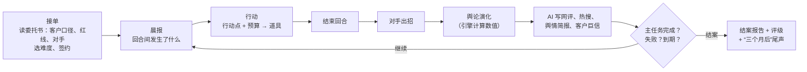
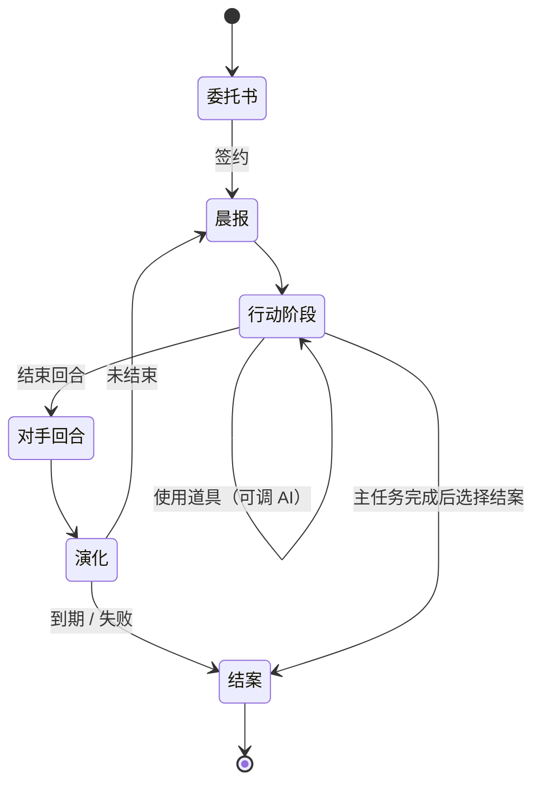
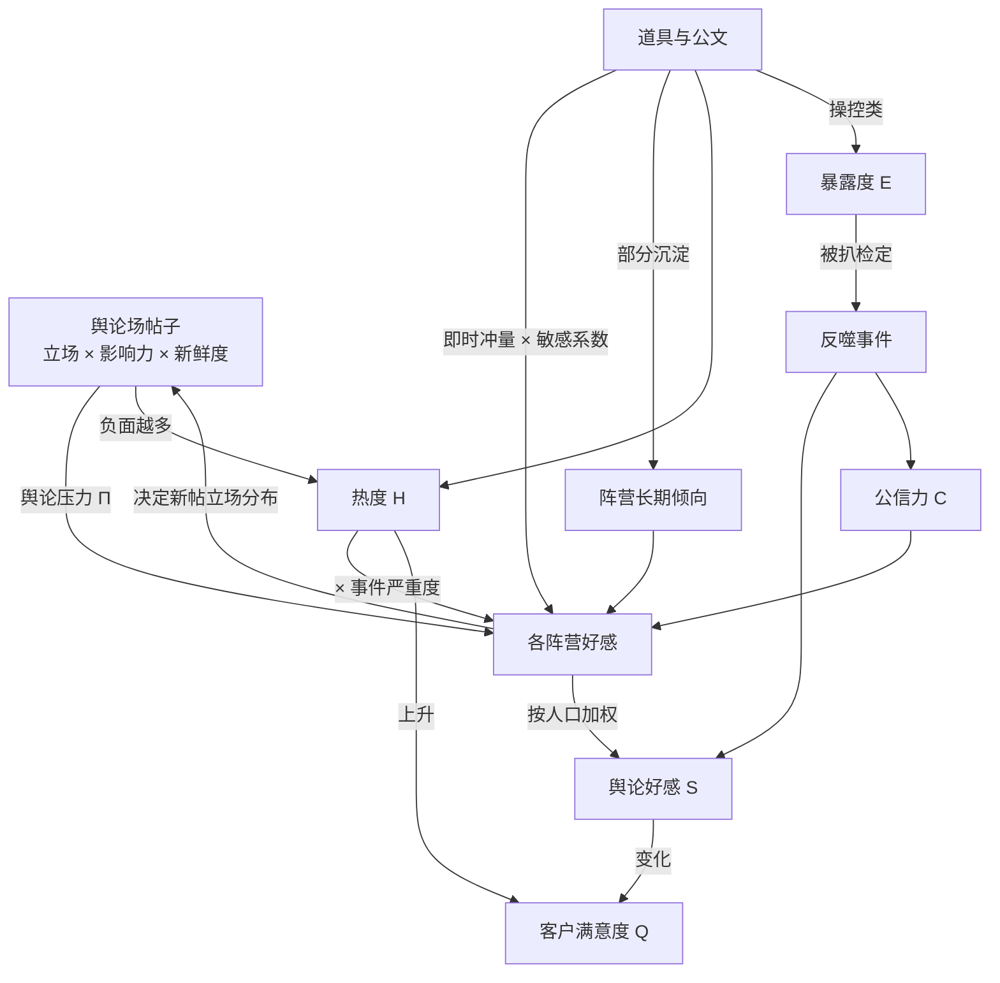
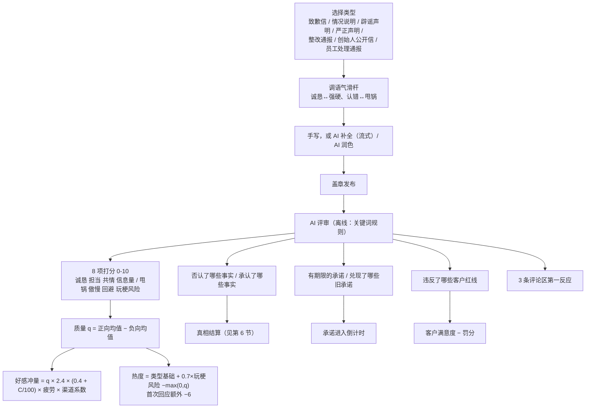
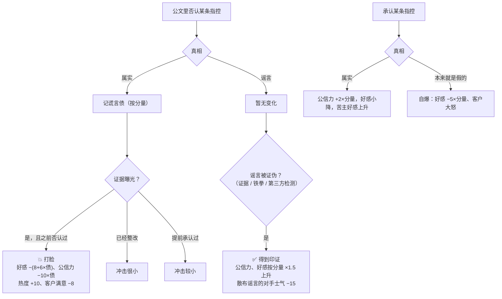
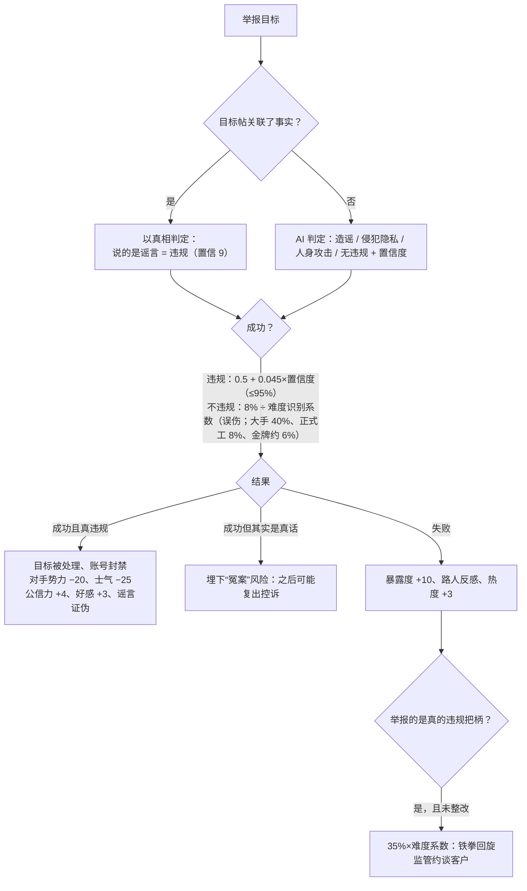
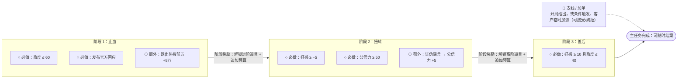
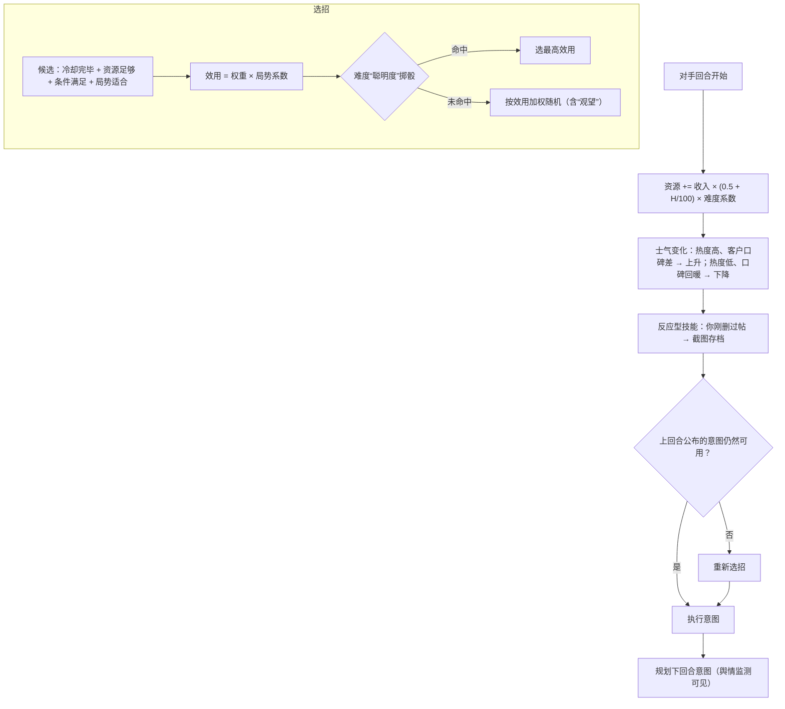
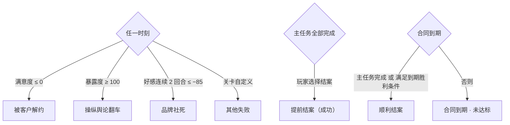

# 玩法机制（Gameplay）

你经营一家危机公关公司「白净危机公关」。每一关是一单委托：客户出了事，给你一笔预算和若干回合，你要在合同期内把舆论“洗”回来——用公文、控评、删帖、水军、召唤铁拳……或者偶尔，说真话。

本文所有数字都来自代码（`js/engine/*`、`js/data/*`），关卡可以通过 `tuning` 和覆盖字段调整。

---

## 1. 核心循环

一关 5–10 个回合，每回合按“第 N 天 白天/深夜”推进。每回合有行动点（默认 3），道具消耗行动点和预算。

---

## 2. 五个数值

| 数值 | 范围 | 作用 | 归零/封顶 |
|---|---|---|---|
| 舆论好感 S | −100~100 | 各阵营好感按人口加权，核心 KPI | 连续 2 回合 ≤ −85 → **品牌社死** |
| 事件热度 H | 0~100 | 越热，负面越容易发酵、水军越难起效；决定舆情阶段与热搜排名 | — |
| 公信力 C | 0~100 | 公文效果的乘数，也抬高或压低各阵营每回合漂移的目标值 | — |
| 暴露度 E | 0~100 | 网友对“有人在操控”的怀疑，越高越容易被扒 | 满 100 → **操纵舆论翻车** |
| 客户满意度 Q | 0~100 | 客户对你的信任 | 归零 → **被客户解约** |

另有预算 B（万元）与行动点 AP。未部署「舆情监测」时，暴露度只显示大致档位，阵营只显示倾向词，对手意图只显示“？？？（类别）”。

### 回合演化公式（`sim.js`）

| 步骤 | 公式（默认参数） |
|---|---|
| 舆论压力 | Π = Σ(立场 × 影响力 × 0.65^帖龄 × 处置系数) ÷ (Σ(影响力 × 0.65^帖龄) + 20)，范围 −2~2；官方帖和已删帖不计；限流 ×0.4，控评后的负面帖 ×0.5 |
| 影响力 | 作者层级（素人 1 / KOL 5 / 大V 12 / 媒体 20 / 官媒 40）× 平台系数（围脖 1.2、颤音 1.3、新闻 1.5……） |
| 阵营漂移 | 目标 = 长期倾向 + 16·Π + 0.3·(C−50) − 严重度·0.25·H/100；好感 += 波动性 ×（目标 − 好感） |
| 热度 | H′ = H·(1 − 0.2) + max(0, −Π)·4·H/100（各关可调衰减率） |
| 暴露度冷却 | 本回合没有操控行为时 −4 |
| 扒水军检定 | p = 0.6 × 该批水军识别度 × (0.25 + E/100) × 难度识别系数 × (0.6 + 4×扒皮党占比) × 0.35，上限 85% |
| 客户满意度 | ΔQ = 0.25·ΔS − 0.25·热度上升量 −（H≥70 时 2）−（单回合花掉初始预算 40% 以上时 4）；扣分 ÷ 客户耐心系数 |

### 冲量与沉淀

每个行动都有一个“作用渠道”（公文、道歉、水军、KOL、律师函、删帖、赔偿、转移话题、强硬定性、反向扒皮、整改、甩锅、事件冲击）。冲量乘以**阵营对该渠道的敏感系数**后加到阵营好感上，同时按渠道的沉淀比例写进阵营的长期倾向：

| 渠道 | 沉淀比例 | 说明 |
|---|---|---|
| 真诚整改 | 0.8 | 改了就是改了，长期有效 |
| 赔偿和解 | 0.6 | |
| 道歉认错 | 0.4 | |
| 公文表态 / 删帖限流 / 事件冲击 / 反向扒皮 | 0.3 | |
| 律师函 / KOL / 强硬定性 | 0.2~0.25 | |
| 甩锅 | 0.1 | |
| 水军控评 | 0.05 | 热闹一阵就散 |
| 转移话题 | 0 | 只是挪走注意力 |

所以水军和转移话题只能“续命”，真正把口碑拉回来要靠整改、道歉、赔偿和公信力。

---

## 3. 受众阵营

默认 6 个阵营（关卡可以改名、改比例、改系数）：

| 阵营 | 占比 | 特点 | 关键敏感系数 |
|---|---|---|---|
| 吃瓜路人 | 42% | 人数最多，容易被带节奏，也最容易忘 | 转移话题 1.2、KOL 1.2、律师函 −0.6 |
| 品牌粉丝 | 16% | 天然护主，爱看强硬表态 | 公文 1.3、强硬定性 1.2、反向扒皮 1.2 |
| 苦主 | 8% | 只认道歉与赔偿 | 赔偿 2.0、整改 1.5、律师函 −1.5、删帖 −1.2 |
| 扒皮党 | 12% | 爱整理时间线，水军与删帖的天敌 | 水军 −0.8、删帖 −1.0、甩锅 −0.6 |
| 媒体大V | 12% | 要信息要立场，讨厌被删稿 | 删帖 −0.9、强硬定性 −0.6 |
| 对家 | 10% | 基本不可能转化，但能被打击 | 反向扒皮 0.6 |

负系数意味着反噬：同一批水军让路人好感上升，却让扒皮党更反感。

---

## 4. 道具图鉴

道具分三层，随主任务阶段解锁（关卡也可以单独写解锁条件）。

| 层级 | 道具 | AP / 价格 | AI 参与 | 效果 | 风险 |
|---|---|---|---|---|---|
| 基础 | 📜 发布公文 | 1 / 1万 | 补全、润色、评审打分 | 按评审换算好感、热度、公信力 | 谎言债、红线、玩梗，同回合连发递减 |
| 基础 | 🦆 水军 | 1 / 0.6~4.5 万每百条 | 按“节奏方向”写样例帖，评估说服力与违和感 | 好感冲量（热度越高越弱） | 暴露度；被扒时冲量 ×1.6 反向返还 |
| 基础 | 🗑️ 删帖 | 1 / 按帖计价 | 按一句话条件筛帖，预览确认 | 移除负面、降热度、推迟可压制的证据 | 大V/媒体贵、官媒和外网删不掉；删帖反噬、截图存档 |
| 基础 | 🛡️ 控评 | 1 / 3万+ | 写热评 | 负面帖：影响减半；任意帖：折叠差评、好评上热评，2 回合内护住不被抱团举报。可以控自家的官方公文、软文、水军帖（官方帖只能控评，不能删帖、限流、发律师函或举报） | 暴露度 |
| 进阶 | 📉 撤热搜 | 1 / 15万 | — | 热度 −25 | 热度 ≥70 时 35% 概率“心虚”反噬，并刺激对手去外网 |
| 进阶 | 🔇 限流降权 | 1 / 删帖价 ×1.5 | 筛帖 | 影响力 ×0.4，更隐蔽 | 官媒和外网限不了 |
| 进阶 | 🍉 买热搜转移话题 | 1 / 12万 | 编一个更大的瓜 | 热度 −12，本回合结算时再 −8 | 重复使用会被识破 |
| 进阶 | ✍️ KOL 软文 | 1 / 5~40 万 | 代写软文并评估说服力 | 路人/媒体好感上升，公信力微升 | 恰饭被扒 |
| 进阶 | ⚖️ 律师函 | 1 / 3万 | — | 震慑大V/对手，可能让对方删帖、压制证据 | 路人反感；发给苦主 = 灾难 |
| 进阶 | 👊 召唤铁拳 | 1 / 5万，冷却 2，限 2 次 | 判定目标是否真违规 | 见第 7 节 | 举报说真话 → 失败，可能铁拳回旋 |
| 进阶 | 🔍 反向扒皮 | 1 / 6万（需舆情监测） | 写扒皮帖 | 对手士气 −30、势力 −10、好感上升 | 对手没把柄就被嘲 |
| 进阶 | 📡 舆情监测 | 1 / 10万，全程生效 | — | 显示精确暴露度、阵营明细、对手意图、证据预警、谎言债 | — |
| 高阶 | 🕵️ 内部摸底调查 | 1 / 8万 | — | 揭示某条“客户口径”是否属实、证据何时可能曝光 | — |
| 高阶 | 🤝 私下和解赔偿 | 1 / 10~50 万 | — | 苦主好感大升、撤下维权帖、压制苦主证据 | 封口协议泄露 |
| 高阶 | 💰 招安收编 | 1 / 按对手势力 | — | 75% 让对手退场 | 受害者群体收买不了；交易泄露 |
| 高阶 | 🙇 临时工背锅 | 1 / 2万 | — | 快速止血 | 公信力 −6；再用就是“又是临时工”；真相指向管理层时记谎言债 |
| 高阶 | 🧪 第三方检测背书 | 1 / 15万 | — | 证伪一条指控：真是谣言则公信力 +12 | 指控其实是真的 → 定时炸弹，曝光时打脸 ×1.5 |
| 高阶 | 🔧 真诚整改 | 2 / 初始预算的 30% | — | 3 回合持续回暖，所有真事实标记“已整改”（堵住铁拳把柄、打脸减半） | 很贵，客户可能大怒 |
| 关卡定制 | ✨ 自定义 AI 道具 | 关卡设定 | 关卡写规则提示词 | AI 在设定的上下限内返回数值和帖子 | 关卡设定 |

---

## 5. 公文系统

疲劳：同回合第 n 篇 ×0.6^(n−1)，整关累计每多一篇 −7%（最低一半）。

---

## 6. 真相、谎言债与打脸

每条事实都有“客户口径”和隐藏真相。客户可能骗你——「内部摸底调查」能查清。

- **证据时间线**：事实可设置“最早曝光回合 + 每回合概率 + 来源”，未曝光时概率每回合 +25%。删帖/和解/律师函能把可压制的证据推迟（最多 3 回合），大额和解可以直接压住。
- **承诺**：公文里的“X 日内公布结果”会变成倒计时；到期前发一篇“情况说明/整改通报”兑现，否则“跳票”：公信力 −8、好感 −5、热度 +5。
- **旧账爆雷**：和解、招安、KOL、假检测报告、冤枉了说真话的人——这些操作会留下“风险”，之后每回合都可能爆雷。

---

## 7. 召唤铁拳（双方对称）

铁拳只砸真违规。谁召唤都一样：看真相。

**对手也会召唤铁拳**：只有当客户的“违规把柄”（标记 `regulatory` 的真事实）已经被证据曝光时，正规对手才会出手，成功率 75% × 势力系数。成功即“监管约谈”：好感 −12、公信力 −10、客户满意 −12、热度 +8，并封锁 KOL/转移话题/水军/撤热搜 2 回合。鲁莽的对手（比如对家粉丝）会在没有实据时乱举报——那就是“诬告翻车”：对手士气 −25、势力 −10，客户公信力 +4。

最好的防守：在证据曝光前**真诚整改**，把把柄变成“已整改”。

---

## 8. 主任务与子任务

下图以「过期原料风波」为例（省略 `objectives` 时的默认三阶段是：热度 ≤ 60 → 好感 ≥ 0 → 好感 ≥ 15 且热度 ≤ 40）。

- **推进度** = 已完成必做子任务 ÷ 必做子任务总数，显示在顶栏。
- 子任务可以有截止回合、失败条件、隐藏（完成才显示），也可以设为“结案时判定”（比如“零水军通关”）。
- 奖励可以是：追加预算、解锁道具、+行动点、一次性免费券、削弱对手、评分加成。失败也可以带惩罚。
- 主任务完成后可以立刻结案（每剩 1 回合 +3 分，最多 +12），也可以继续经营冲更高评级。

---

## 9. 对手盘

每关 1~3 个对手。属性：**势力**（招式力度，力度系数 = 势力/50 × 难度系数）、**士气**（归零即偃旗息鼓）、**资源**（出招消耗，每回合按热度增长）。

### 经典技能库

| 技能 | 什么时候爱用 | 效果 | 怎么应对 |
|---|---|---|---|
| 🚩 抱团举报 | 你最近发了公文、软文或水军 | 按比例下架近两回合的这些内容（水军 60%、软文 35%、官方 15%），封号抬高暴露度；没有可举报的内容时不会出这一招 | 先控评护住（2 回合内不会被冲掉）、对其召唤铁拳 |
| 🌐 告洋状 | 热度 ≥45，且你删过帖或撤过热搜 | 外网帖删不掉也限不了流，热度上升、公信力下降；但“告洋状”也让对手自身势力 −8、粉丝反而抱团 | 冷处理、发澄清公文；越压越容易逼它出手 |
| 🧲 吃黑流量 | 热度 ≥40，越热越爱用 | 营销号批量产黑稿，热度上升，还能赚回资源 | 把热度降下来断它的流量；律师函、限流，对造谣黑稿召唤铁拳 |
| 👊 召唤铁拳 | 握有已曝光的违规把柄 | 监管约谈（见第 7 节）；无实据则诬告翻车 | 证据曝光前真诚整改 |
| 📼 翻旧账 | 第 3 回合以后 | 挖出客户黑历史（新增事实，真的立即实锤） | 预先摸底、KOL 先定调 |
| 🗯️ 造谣带节奏 | 随时 | 制造一条新谣言（假事实）并大量转发 | 辟谣（真相站在你这边时公信力会涨）、召唤铁拳 |
| 📸 截图存档 | 你刚删过帖（反应型，不占意图） | 被删内容以截图形式重新流传，暴露度上升 | 少删多限流 |
| 🐟 买水军反打 | 对家品牌专属 | 一批抹黑水军——这也是它的把柄 | 舆情监测识破 → 反向扒皮 |

关卡还可以给对手配**专属事件**（例如“前助理开直播哭诉”），以及用效果列表实现的**专属技能**。

---

## 10. 难度

| 档位 | 预算 | 行动点 | 暴露增长 | 被扒/泄露概率 | 对手力度 | 对手聪明度 | 客户耐心 | 开局修正 | 网友敏锐度（写进 AI 提示词） |
|---|---|---|---|---|---|---|---|---|---|
| 🫳 看不见的大手 | ×2 | 不限 | ×0.2 | ×0.2 | ×0.6 | 0 | ×1.4 | 好感 +8、热度 −5 | 好糊弄 |
| 💼 正式工 | ×1 | 0 | ×1 | ×1 | ×1 | 0.3 | ×1 | — | 正常 |
| 🏅 金牌公关 | ×0.85 | 0 | ×1.25 | ×1.3 | ×1.3 | 0.6 | ×0.8 | 好感 −3 | 爱较真 |

**看不见的大手**是爽局档（内部 id 仍是 `intern`）：你就是舆论场背后那只手。

- 所有技能开局可用，不耗行动点，无视冷却、次数上限、前置条件和封锁，只受预算约束；
- 作用于全体阵营的有利舆论冲量 ×2.5（`powerMul`）：出手更见效（只改单个阵营好感的效果不放大）；
- 自己的操作带来的伤害吸收 70%（`cushion`）：扒皮扑空、公文翻车、被嘲“控评”之类的自伤只剩三成；对手出招和突发事件不受影响；
- 暴露度每回合按 30% 自然消退（`exposureRelief`），即使这回合一直在操控。

效果（开发期一次性的狂刷测试，每关 10 局；该脚本未收录进仓库）：每回合刷 5 次控评/删帖/水军/全套操控，四关都不再“翻车”或“社死”；只有每回合刷 12 批水军这种极端滥用，在“智驾刹车门”仍会把暴露度刷爆。纯操控能过教程和顶流，但“过期原料”“刹车门”的主任务绑定真相（证据必然曝光、需要召回或承认），只控不改会合同到期未达标。

地狱档已移除；旧的地狱存档读档时按金牌公关继续。

关卡可以覆盖任意档位的参数，或只开放部分档位；成绩按“关卡 × 难度”分别记录。

---

## 11. 胜负与评级

**结案评分**（0~100）：

| 组成 | 换算 | 默认权重 |
|---|---|---|
| 舆论好感 | (S + 100) / 2 | 35% |
| 热度控制 | 100 − H | 15% |
| 公信力 | C | 15% |
| 客户满意 | Q | 15% |
| 预算结余 | 结余 / 初始预算 × 150（封顶 100） | 10% |
| 隐蔽程度 | 100 − E | 10% |

总分 = 加权分 ×（主任务完成 ? 1 : 0.55 + 0.45 × 推进度）+ 加分（每个完成的可选/支线子任务 +3、`score` 效果、提前结案）。失败时最高 40 分。评级线：S ≥ 85、A ≥ 72、B ≥ 60、C ≥ 45，其余 D。结案时 AI 写一份《结案报告》和一段“三个月后……”的尾声（离线时用模板）。

**存档与战绩**：每次签约开局自动新建一份存档，每个操作后自动保存；同一关可以同时有多份没打完的存档，在委托书里挑一份继续。打完的局保留为战绩。首页「🗂 存档」列出所有对局，可以继续、收藏（⭐，不会被自动清理）、删除，或「查看记录」：结局评级、数值走势、按回合整理的经过、发过的公文全文、客户来信和结案报告。

**写成爽文**：结案页或存档里点「✍️ 写成爽文」，选短篇（约 1500 字）或长篇（约 4000 字）、填主角名，AI 根据这局的真实经过写一篇分章节的爽文（输了就写成黑色幽默），可以复制或下载 .md，结果存进这份存档。没有配置 AI 时用模板生成简版。

---

## 12. 内置关卡

| 关卡 | 难度 | 规模 | 核心考验 |
|---|---|---|---|
| 🦞 小龙虾店卫生风波（教程） | ★ | 5 回合 · 35 万 | 左下角教程卡片一步步带到结案（高亮目标、预选目标、示范稿）；“死虾”是谣言，用铁拳证伪；后厨脏是真的，完成第一阶段就能整改 |
| 🧋 过期原料风波 | ★★ | 8 回合 · 80 万 | 客户红线不许承认食品安全问题，可证据第 3 回合就来；对家握着真把柄等着召唤铁拳 |
| 🎤 顶流人设崩塌 | ★★★ | 8 回合 · 120 万 | 真假混杂：耍大牌是真、霸凌是假、恋爱是真；粉丝是资产也是负债；对家粉丝会乱举报 |
| 🚗 智驾刹车门 | ★★★★ | 10 回合 · 300 万 | 扒皮党占比大，水军极易反噬；召回很贵且客户抵触，但几乎是高评级的必经之路 |
| 🎬 月球摄影棚疑云 | ★★★★ | 8 回合 · 100 万 | 替反智学会把“登月造假”炒上热搜：靠水军和定向技能拉拢跟风青年与信徒，用扒皮压住科普联盟，第三阶段还要背锅或和解，并安抚平台与监管。不认错也能过，但暴露度一满就翻车 |

---

## 13. 难度曲线与平衡数据

`node tests/run.js --balance 20 --diffs intern,regular,gold --strats idle,shill,honest,smart` 的结果（每格 20 局）。策略说明：**摆烂**什么都不做；**全水军**只用水军、删帖、控评、撤热搜、转移话题；**真诚**道歉、整改、和解、兑现承诺；**高手**知道隐藏真相（相当于查清了所有事实的熟练玩家），辟谣、铁拳打谣言、证据曝光前整改、扒对家、适度删帖与 KOL。

| 关卡 | 难度 | 摆烂 | 全水军 | 真诚 | 高手 |
|---|---|---|---|---|---|
| 教程 | 大手 | 0% | 75% | 100%（全 S） | 100% |
| 教程 | 正式工 | 0% | 0% | 100% | 100% |
| 教程 | 金牌 | 0% | 0% | 100% | 95% |
| 过期原料 | 大手 | 0% | 0% | 100%（全 S） | 100%（全 S） |
| 过期原料 | 正式工 | 0% | 0% | 5% | 95% |
| 过期原料 | 金牌 | 0% | 0% | 0% | 95% |
| 顶流塌房 | 大手 | 0% | 55% | 100%（全 S） | 100%（全 S） |
| 顶流塌房 | 正式工 | 0% | 0% | 50% | 80% |
| 顶流塌房 | 金牌 | 0% | 0% | 0% | 15% |
| 智驾刹车门 | 大手 | 0% | 0% | 100%（全 S） | 100%（全 S） |
| 智驾刹车门 | 正式工 | 0% | 0% | 0% | 70% |
| 智驾刹车门 | 金牌 | 0% | 0% | 0% | 35% |

读法：

- **教程照做就能过**：只照教程卡片操作（读完说明、按卡片上的按钮、用示范稿）在大手/正式工/金牌各 60 局全部通关、几乎全 S。教程关的「后厨大整改」在完成第一阶段后就解锁，所以“真诚”路线在教程里各难度都能赢。
- **只洗不改必败**：全水军在正式工、金牌档的所有关卡都是 0%，绝大多数死于“操纵舆论翻车”。只有爽局“看不见的大手”里它不会翻车，教程和顶流甚至能赢。
- **只认错也不够**：真诚路线在“过期原料”正式工档只有 5%——客户红线和满意度会把你拖死，需要在客户和舆论之间找平衡。
- **信息就是力量**：知道真相的“高手”在正式工档 70%~100%，这正是「内部摸底调查」和「舆情监测」存在的意义。
- 金牌档的“顶流”和“刹车门”对机器人很难（多死于暴露度）——它们留给愿意精打细算的人类玩家。

## 14. 通关测试（关卡合理性体检）

编辑器的「🧪 通关测试」和 `node tests/run.js --check <关卡>` 用同一套逻辑（`js/editor/levelcheck.js`），全部走离线规则，不调用 AI。

**扫哪些打法**（`js/engine/bots.js`）：

| 维度 | 取值 |
|---|---|
| 口径 | 认错（承认属实的、辟谣不实的，配整改措施）/ 只辟谣（真事不提）/ 全盘否认 / 甩锅（先用「临时工背锅」，公文发“员工处理通报”，真事推给涉事员工） |
| 信息面 | 看透真相（相当于判断全对的玩家）/ 先查证（每回合调查一件）/ 不查证。后两种只用玩家看得到的信息 |
| 整改 | 尽早 / 被逼才整改（真事曝光、被约谈或热度 > 75）/ 不整改 |
| 压制 | 不压制 / 轻（撤热搜、控评、转移话题）/ 重（再加删帖、限流、法务） |
| 水军 | 不用 / 少量精品 / 大量 |
| 战术 | 铁拳打谣言、权威背书、和解、扒皮、招安、腰部 KOL 补刀、拒接加单（婉拒客户的可选加单）、不避红线（公文不绕开客户红线关键词），每项 50% 抽取 |
| 覆盖战术 | 照任务清单做（进行中任务的条件要用哪个技能就去用；要拉某个阵营的好感，就用专门作用于它的自定义技能，或它特别敏感（≥1.3）的渠道上的技能）、什么技能都试试（本局还没用过的已启用技能各用一次，含自定义道具）。它们会把行动点和预算从正常打法里挪走，所以不参与抽签，只放在单独的“探索打法”上；两者都只在打法自己的轴允许的范围内选技能（不整改的不会整改，不压制的不会删帖，不查证的不会调查，公文只按口径节奏发） |

所有打法都带同一套基本功（舆情监测、大 V 软文、隔回合发公文；进行中的任务要拉某个阵营的好感，而关卡里有专门作用于它的自定义技能时，每回合用一次），这套骨架来自平衡表里的“高手”，只是去掉了偷看真相。口径 × 整改 × 压制 × 水军共 108 种组合先铺满，信息面轮换，战术随机；另加固定基线（摆烂、全水军、真诚、平衡、开天眼高手；有教程卡片时加“照教程做”）、一个“高手打法”锚点（开天眼高手写成打法参数，胜率与它接近）和一批探索打法（快速 / 标准 / 深入 12 / 24 / 48 个）。“和解”看的是关卡自己的结构：默认苦主阵营好感 < -50、有在场的受害者群体对手、或有和解能压住的真事证据，任一成立即可，所以自定义阵营的关卡也会和解。

扫法分三轮。第一轮：快速 / 标准 / 深入分别扫 36 / 108 / 216 种打法，每种每档先跑 3~4 局。第二轮（邻域）：取正式工档总体、只凭可见信息、掩盖路线、重压制 + 大量水军这四组里各自领先的打法（深入各取 2 个），把它们的邻居也跑一遍：换成另外两种信息面，或开关一项战术。这样“同样的打法不偷看真相能赢多少”总会被测到，不取决于随机抽到了什么。第三轮（补局）：给结论可能引用的打法补到 8 / 10 / 16 局，包括各档前 10 名、每组前几名、每种口径的最佳，以及领先打法换信息面后的版本；补完后哪组的领先者换了人、又还没补满，就接着补，直到每组领先者都补满。结论里的最佳胜率只在补满局数的打法里取，不会出现“3 局赢 2 局 = 67%”这种数。“多少比例的打法能赢”和中位数只统计第一轮的打法，不含探索打法、邻居和锚点。

**判定**（以正式工档为主）：

| 结论 | 规则 |
|---|---|
| ✗ 不可通关 | 没有任何打法赢过 |
| ! 很难 | 最好的打法胜率 < 30% |
| ! 只有看透真相才能赢 | 最佳胜率 ≥ 30%，但只凭可见信息的最佳 < 20% 且不到一半——玩家分不清谣言 |
| ✗ 太容易 | 摆烂能赢 |
| ! 太容易 | 超过 70% 的打法胜率 ≥ 50%，或获胜局平均在合同前 35% 的回合（至少 2.5 回合）内就结案 |
| ! 洗地无风险 | 全水军基线能赢，或“重压制 + 大量水军 + 不整改”的打法胜率 ≥ 30% |
| ! 路线与意图不符 | 意图“认错才能过”而掩盖路线 ≥ 40%，或认错路线自己 < 30%；意图“掩盖也能过”而掩盖路线 < 20%。路线按每局实际发生的事算：承认过事实或整改过算认错，否则算掩盖 |
| i 实际只有一条路 | 意图“都可以”时，一条路线 ≥ 50% 而另一条 < 10% |
| ! 难度倒挂 | 高一档的最佳胜率比低一档高出 15 个百分点以上；或大手档最好也不到 80% |
| ✗ / ! 任务 | 必做子任务出现过却一次都没完成（红）；支线从没发放或从没完成（黄）。如果任务条件要用的技能扫参从没用过（见下一行），必做任务降为黄，并注明可能是测试没覆盖。每条都会附上诊断：条件里每个数值在所有局里最好达到多少（例如“好感最好只到 14，差 21”）；这些局里超过 60% 以同一种方式失败时写出来（例如“63% 以「操纵舆论翻车」告终”）；要用的技能在这一档从未解锁时写出来。编辑器里还有“门槛改成 …”按钮，按扫参最好值（取 5 的倍数）改门槛 |
| i 阶段未测到 | 某个阶段在主难度从未解锁时，报出后面一共有多少个子任务没被测到，并指向卡住它的那个必做任务 |
| i 技能覆盖 | 每局记下用过的技能和解锁过的技能。有技能解锁了却没有任何打法用过时，列出它们：依赖它们的结论不可靠。从没解锁的技能不算盲区（是关卡阶段没推进到），编辑器里在结论下方单独列出 |
| ! 静态检查 | `Schema.validate` 的阻断项：开局即完成、标记没有任何效果会设置、技能未启用、必做任务的技能在本阶段还没解锁，以及 `feasibility.js` 判定数据上做不到的任务（见 [LevelFormat.md](LevelFormat.md#做不到的任务jsenginefeasibilityjs)） |
| i 主要死因 | 某种失败占失败局 80% 以上（失败局至少 10 局） |
| i 金牌档无人能赢 | 正式工档能赢，但金牌档机器人一局都赢不了 |

内置关卡的标准深度结果：教程、过期原料、顶流塌房没有红黄结论（过期原料提示“实际上只有认错路线能过”，符合设计）；智驾刹车门的支线「先查清楚再说话」从没完成（第 5 回合前要用到 3 级技能「内部摸底调查」），只凭可见信息的最佳打法（尽早召回 + 反向扒皮）胜率 20%，开天眼 70%。

### 自动调优（`js/editor/leveltune.js`）

通关测试对话框里的「🔧 自动调优」，以及 `node tests/run.js --tune <关卡> [--out 文件]`，会循环执行"检测 → 修 → 快速测试 → 判断有没有变好"，直到关卡"做得到"。全程不调用 AI。AI 生成关卡完成后，摘要里也有这个入口。

- **达标条件**：主难度最好的打法胜率 ≥ 30%，每个必做子任务出现过、并在出现的局里至少 10% 完成。这两个数可以在对话框里改，会记在浏览器里；命令行用 `--min-win`、`--min-task` 指定。轮数上限默认 10 轮，可以用 `--rounds` 改。支线也会尝试修，但不算进达标条件。关卡已经达标后，修支线不许让它掉回不达标。
- **手段**：只用现成的修复，不另造规则，从轻到重：
  1. 静态检查给出的补杠杆，顺序是专属技能、反向扒皮、渠道敏感度、律师函、性格模板；
  2. 补完还不行，才放宽门槛：取任务出现过的局里，约 15%（达标完成率的 1.5 倍）能达到的值，向容易的一侧取整。门槛不能改成开局就满足的值；数值从来没动过的条件不放宽。
- **每一轮**：给每个卡住的任务各上一级手段。同一阵营或同一对手的任务轮流来，免得把效果记到别的手段头上。然后在主难度上用固定抽样跑一次快速测试。完成率上升，或离门槛更近的手段保留，其余撤掉，下一轮换下一级。前面阶段修好后，后面阶段第一次被测到，它们的问题在下一轮自然加进来。
- **收尾**：用标准深度、全部难度给调优前后各测一次。修改清单写明每处改了什么字段、完成率从多少到多少。修不了的列为"需要手动处理"，例如任务都有人完成，但多数局输给了某个失败条件。改动先放在副本上，点「采用」才写进关卡。

「月球摄影棚疑云」原稿在正式工档无人能过。自动调优跑了 4 轮，改了 8 处：加了 3 个专属技能，启用扒皮，放宽 4 处门槛。之后第 1~3 阶段能推进了，但最佳胜率仍是 0%，被列为需要手动处理。

之后又手动改了三处：
- 监管门槛从 -15 放宽到 -55；
- 开局暴露度从 20 降到 5；
- 「自查」任务也认背锅与和解。

改完之后，换 4 个抽样种子做标准深度测试：正式工档最佳胜率 50%~80%，掩盖路线 40%~80%，没有红色结论。其余 4 个内置关卡开局就达标，自动调优不做修改。

机器人的局限：它们写的是模板公文，离线评审只认关键词，所以“措辞好不好”测不出来；真人会用的一些巧招（比如按帖子内容猜谣言）机器人也不会。结论应理解为“这关在规则层面是否讲得通”，不是真人体验。
