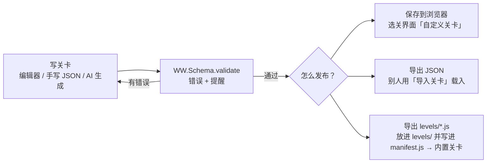

# 关卡格式与制作（LevelFormat）

关卡是一个纯 JSON 对象。引擎用 `WW.Schema.normalize()` 补齐所有省略的字段，所以一个能玩的关卡可以很短；编辑器和引擎共用 `WW.Schema.validate()`，编辑器里校验通过的关卡，引擎一定能跑。



---

## 1. 最小可玩关卡

```json
{
  "id": "hotpot",
  "meta": { "title": "火锅店地沟油风波", "cover": "🍲" },
  "client": { "name": "辣翻天火锅", "contact": "刘老板" },
  "incident": { "summary": "顾客拍到后厨回收锅底油，视频疯传。", "keywords": ["回收锅底", "地沟油"], "severity": 60 },
  "facts": [
    { "id": "f1", "text": "后厨回收锅底油", "clientClaim": "视频是剪辑的", "isTrue": true, "regulatory": true, "keywords": ["锅底", "回收"],
      "evidence": { "turn": 4, "chance": 0.7, "source": "离职厨师", "suppressBy": ["settle"] } },
    { "id": "f2", "text": "全国门店都用地沟油", "clientClaim": "只是个别门店", "isTrue": false, "keywords": ["全国", "地沟油"] }
  ],
  "contract": { "turns": 6, "budget": 60 },
  "seedPosts": [
    { "author": "吃辣达人", "tier": "bigv", "platform": "douyin", "stance": -2, "fact": "f1", "content": "后厨实拍：锅底捞出来又倒回去……" }
  ],
  "items": { "enabled": ["statement", "shill", "delete", "control", "kol", "iron_fist", "monitor", "investigate", "rectify"] }
}
```

省略的字段会使用默认值：默认 6 个阵营、3 个主任务阶段（止血 → 扭转 → 善后）、默认随机事件池、默认失败条件、默认评分权重。

---

## 2. 字段说明

| 字段 | 类型 | 说明 |
|---|---|---|
| `id` | 字符串 | 小写英文/数字/下划线；存档与成绩的键 |
| `meta` | 对象 | `title` 标题、`subtitle`、`cover` 封面 Emoji、`difficulty` 星级 1~5、`order` 排序、`description` 简介、`tags`、`author` |
| `client` | 对象 | `name` 委托方、`contact` 联系人、`persona` 人设（影响 AI 写的客户巨信）、`intro` 开场白、`acceptsRectify` 能否接受整改、`demands` 红线、`expectations` 阶段期望 |
| `client.demands[]` | 对象 | `id`、`text`、`keywords`（离线判定用的关键词）、`penalty` 违反时扣的满意度 |
| `client.expectations[]` | 对象 | `byTurn` 检查回合、`condition` 期望条件、`penalty`、`text` 客户抱怨 |
| `incident` | 对象 | `summary` 概要、`background`、`keywords` 关键词（离线文本和热搜会用）、`severity` 严重度 0~100（越高，热度对好感的压制越强） |
| `facts[]` | 对象 | 见下表 |
| `contract` | 对象 | `turns` 回合数、`actionPoints` 每回合行动点、`budget` 预算（万元）、`slotsPerDay` 每天回合数 1/2/3、`turnLabels` 自定义回合名 |
| `difficulty` | 对象 | `allowed` 开放的难度（intern/regular/gold/hell）、`overrides` 按档位覆盖参数 |
| `initialStats` | 对象 | 开局的 `sentiment` `heat` `credibility` `exposure` `satisfaction` |
| `tuning` | 对象 | 演化参数：`heatDecay` `pressureWeight` `credibilityWeight` `severityWeight` `spreadWeight` `exposureCooldown` `detectBase` `randomEventChance` `organicPosts` |
| `factions[]` | 对象 | `id` `name` `desc` `size` 人口占比、`sentiment` 开局好感、`bias` 长期倾向、`volatility` 波动性 0~1、`sens` 各渠道敏感系数 |
| `platforms` | 数组 | 启用的平台：weibo douyin xiaohongshu zhihu bilibili tieba news overseas |
| `personas[]` | 对象 | 常驻网民：`id` `name` `faction` `tier`（normal/kol/bigv/media/state）`platform` `style`，可用 `opp` 归属某个对手 |
| `seedPosts[]` | 对象 | 初始帖子：`persona` 或 `author`+`tier`+`faction`、`platform`、`stance` −2~2、`fact` 关联事实、`opp` 对手账号、`likes`、`tags`、`content`、`comments` |
| `items` | 对象 | `enabled` 启用的库道具、`startTier` 开局层级、`unlocks` 单独解锁条件、`overrides` 参数覆盖、`custom` 自定义 AI 道具 |
| `objectives` | 对象 | `stages` 主任务阶段、`side` 支线 |
| `opponents[]` | 对象 | 对手，见第 5 节 |
| `abilities[]` | 对象 | 本关专属对手技能，见第 5 节 |
| `events[]` | 对象 | 脚本事件：`id` `title` `text` `trigger` 条件、`chance`、`once`、`effects` |
| `randomEvents[]` | 对象 | 随机事件池：`id` `title` `weight` `condition` `once` `effects`（省略则用默认池） |
| `victory` | 对象 | `condition` 到期胜利条件、`text` |
| `defeat[]` | 对象 | 追加失败条件；`id` 与默认的 `fired` `exposed` `collapse` 同名则覆盖 |
| `grading` | 对象 | `weights`（sentiment heat credibility satisfaction budget exposure）、`thresholds`（S A B C） |
| `guide[]` | 对象 | 教程步骤 / 提示，见第 8 节 |
| `ai` | 对象 | 写进 AI 系统提示词：`context` 补充设定、`style` 文风、`extraRules` 额外要求 |
| `offline` | 对象 | 离线文本池，结构同 `js/data/pools.js`，会和内置文本池合并 |

### 事实 `facts[]`

| 字段 | 说明 |
|---|---|
| `id` | 被条件、帖子、效果引用 |
| `text` | 指控内容（网民看到的说法） |
| `clientClaim` | 客户口径（委托书里给玩家看） |
| `isTrue` | 隐藏真相：属实 / 谣言 |
| `regulatory` | 属实时是否构成“违规把柄”（证据曝光后对手可以召唤铁拳） |
| `weight` | 分量 0.5~3，决定打脸和证伪的幅度 |
| `keywords` | 离线评审靠它判断公文是否否认/承认了这条事实 |
| `tags` | 例如 `management`（真相指向管理层，甩锅会记谎言债） |
| `publicAtStart` | 开局是否已在网上流传（默认是） |
| `evidence` | `turn` 最早曝光回合、`chance` 每回合概率、`source` 来源、`suppressBy` 可推迟它的手段（delete / settle / legal） |

谣言（`isTrue: false`）也可以有 `evidence`：那是“真相大白”的时间，到时谣言被证伪。

---

## 3. 条件 DSL

```text
{ "var": "stats.heat", "op": "<=", "value": 60 }                     单个条件
{ "all": [ 条件, 条件, ... ] }                                        全部满足
{ "any": [ 条件, 条件, ... ] }                                        任一满足
{ "not": 条件 }                                                       取反
```

省略或 `null` 表示“无条件”。比较符：`<` `<=` `>` `>=` `==` `!=`。布尔值按 1/0 比较。

| 变量 | 含义 |
|---|---|
| `stats.sentiment` `stats.heat` `stats.credibility` `stats.exposure` `stats.satisfaction` | 五个数值 |
| `budget` `ap` `turn` `turnsLeft` | 预算、剩余行动点、当前回合、剩余回合 |
| `difficulty` | 难度，可写 `"regular"` 等 id 比较大小 |
| `phase` | 舆情阶段 0 平息 ~ 3 爆发 |
| `trend.rank` | 话题热搜排名（99 = 榜外） |
| `lieDebt` `progress` `stage` | 谎言债、主任务推进度 0~1、已完成阶段数 |
| `posts.negative` `posts.positive` `posts.deleted` | 可见负面帖数、正面帖数、累计删帖数 |
| `faction.<阵营id>` | 阵营好感 |
| `opp.<对手id>.morale` / `.strength` / `.active` | 对手士气、势力、是否在场 |
| `fact.<事实id>.revealed` / `.refuted` / `.admitted` / `.denied` / `.known` / `.fixed` / `.isTrue` | 事实状态 |
| `task.<任务id>.done` / `.failed` / `.active` / `.offered` / `.declined` | 子任务 / 支线状态 |
| `result` | 结局：`"win"` / `"lose"`，结案前为空（用于结算页的教程小结） |
| `itemUses.<道具id>` / `itemUsesTurn.<道具id>` | 道具累计 / 本回合使用次数 |
| `flags.<名称>` | 剧情标记（由 `flag` 效果设置） |
| `counters.<名称>` | 计数器：`violations` 红线违规次数、`exposeSuccess` 扒皮成功、`faceSlaps` 被打脸、`regulated` 被约谈、`shillExposed` 水军被扒…… |

---

## 4. 效果 DSL

效果是数组，按顺序执行：

| `type` | 字段 | 说明 |
|---|---|---|
| `stat` | `stat` `delta` | 改数值；`sentiment` 会平均作用到所有阵营 |
| `faction` | `faction` `delta` | 改单个阵营好感 |
| `budget` | `delta` | 追加/扣除预算 |
| `ap` | `delta` `permanent` | 行动点；`permanent` 为真时改每回合上限 |
| `unlock` | `tier` / `items` | 解锁道具层级或指定道具 |
| `lockItem` | `items` `turns` | 封锁道具若干回合 |
| `voucher` | `item` `count` | 一次性免费券（免预算） |
| `posts` | `count` `stance` `hint` `fact` `platform` `tier` `faction` `tags` | 让舆论场出现帖子：AI 按 `hint` 写，离线时用模板 |
| `reveal` | `fact` | 立即曝光（真事实）或证伪（谣言） |
| `addFact` | `fact: {text, isTrue, regulatory, weight}` | 新增一条事实 |
| `opponent` | `opp` `strength` `morale` `resources` `active` | 改对手属性；`active: false` 让对手退场 |
| `offerTask` | `task` | 发放一条支线 |
| `score` | `delta` | 结案评分加减 |
| `message` | `from`（client/system/news）`text` | 客户巨信或系统消息，可用 `{client}` `{contact}` `{kw}` |
| `headline` | `text` `heat` `tag` | 塞一条热搜（`tag`：爆/热/新） |
| `flag` | `name` `value` | 设置剧情标记 |
| `modifier` | `stat` `delta` `turns` | 持续若干回合、每回合生效 |
| `chance` | `p` `then` `else` | 概率分支 |
| `if` | `cond` `then` `else` | 条件分支 |
| `end` | `result`（win/lose）`title` `text` | 直接结束关卡 |

---

## 5. 对手与技能

```json
{
  "id": "rival_brand", "name": "沏刻茶研", "avatar": "🍵", "desc": "竞品，最会蹭热度",
  "faction": "rival", "kind": "brand", "strength": 55, "morale": 60, "resources": 25, "income": 7, "cooptable": true, "platform": "weibo",
  "abilities": [ { "use": "counter_shill", "weight": 3 }, { "use": "iron_fist", "weight": 4 }, { "use": "dig_past", "weight": 2 } ],
  "pastScandals": [ { "text": "两年前就因隔夜茶底被罚过款", "isTrue": true } ],
  "rumors": [ "老板已经跑路了" ],
  "dirt": [ "给营销号打钱写拉踩通稿" ],
  "events": [ { "id": "oe1", "title": "发布会抢话题", "trigger": { "var": "turn", "op": ">=", "value": 4 }, "effects": [ { "type": "stat", "stat": "heat", "delta": 5 } ] } ]
}
```

| 字段 | 说明 |
|---|---|
| `kind` | brand 品牌 / group 群体 / person 个人 / victims 受害者群体（不可收买，发律师函 = 灾难） |
| `strength` `morale` `resources` `income` | 势力、士气、初始资源、每回合资源 |
| `startActive` `enterWhen` | 开局不在场时，满足条件后入场 |
| `abilities[]` | `use` 技能 id、`weight` 权重、`cooldown` 冷却、`condition` 额外条件、`overrides` 参数覆盖（如 `{"params":{"requiresHandle":false}}` 让它没把柄也敢乱举报） |
| `rumors` `pastScandals` `dirt` | 造谣内容、翻旧账素材、它自己的把柄（反向扒皮用） |
| `events[]` | 专属事件 |

技能库：`mass_report` 抱团举报、`go_abroad` 告洋状、`black_traffic` 吃黑流量、`iron_fist` 召唤铁拳、`dig_past` 翻旧账、`rumor` 造谣带节奏、`archive` 截图存档、`counter_shill` 买水军反打（效果见 [Gameplay.md](Gameplay.md#9-对手盘)）。

**专属技能**（`abilities[]`）用效果列表实现：

```json
{ "id": "live_cry", "name": "直播哭诉", "icon": "📱", "cost": 6, "cooldown": 3, "weight": 2,
  "condition": { "var": "stats.heat", "op": ">=", "value": 40 },
  "effects": [ { "type": "stat", "stat": "heat", "delta": 6 }, { "type": "faction", "faction": "victim", "delta": -5 } ],
  "posts": 2, "stance": -2, "aiHint": "爆料人开直播哭诉，直播间涌入几十万人" }
```

然后在对手的 `abilities` 里写 `{ "use": "live_cry" }`。

---

## 6. 主任务与支线

```json
"objectives": {
  "stages": [
    { "id": "s1", "title": "止血",
      "rewards": [ { "type": "unlock", "tier": 2 }, { "type": "budget", "delta": 20 } ],
      "tasks": [
        { "id": "m1", "title": "热度降到 60 以下", "required": true, "complete": { "var": "stats.heat", "op": "<=", "value": 60 } },
        { "id": "m1x", "title": "（额外）跌出热搜前五", "required": false, "complete": { "var": "trend.rank", "op": ">", "value": 5 },
          "rewards": [ { "type": "budget", "delta": 8 } ] }
      ] }
  ],
  "side": [
    { "id": "no_shill", "title": "零水军通关", "offer": "start", "at": "end",
      "complete": { "var": "itemUses.shill", "op": "==", "value": 0 }, "fail": { "var": "itemUses.shill", "op": ">", "value": 0 },
      "rewards": [ { "type": "score", "delta": 5 } ] },
    { "id": "new_product", "title": "新品造势", "from": "client", "choice": true, "deadline": 6,
      "offer": { "var": "turn", "op": ">=", "value": 4 },
      "complete": { "var": "stats.sentiment", "op": ">=", "value": 15 },
      "rewards": [ { "type": "budget", "delta": 25 } ], "penalty": [ { "type": "stat", "stat": "satisfaction", "delta": -10 } ] }
  ]
}
```

| 字段 | 说明 |
|---|---|
| `required` | 必做（阶段内必做全部完成才进入下一阶段）；`false` 为可选额外任务 |
| `complete` / `fail` | 完成条件 / 失败条件（必做任务不会因 `fail` 失败） |
| `deadline` | 必须在该回合结束前完成 |
| `at: "end"` | 只在结案时判定（适合“零水军”“守住红线”这类整局约束） |
| `hidden` | 完成后才显示（彩蛋成就） |
| `offer` | 支线发放时机：`"start"` 或一个条件 |
| `choice` | 需要玩家接受（客户“加单”） |
| `from` | client 客户 / system 系统 |
| `rewards` / `penalty` | 效果列表 |

---

## 7. 自定义 AI 道具

```json
"items": {
  "custom": [
    { "id": "fan_army", "name": "粉丝反黑站", "icon": "💖", "tier": 1, "ap": 1, "cost": 4, "channel": "shill",
      "desc": "动员后援会反黑控评", "risk": "路人反感",
      "effect": {
        "prompt": "玩家动员粉丝后援会集体反黑控评。粉丝好感明显上升，路人可能反感……",
        "inputLabel": "反黑口号 / 方向",
        "bounds": { "sentiment": [-4, 6], "heat": [0, 6], "exposure": [1, 6] },
        "offlineDeltas": { "sentiment": 3, "heat": 3, "exposure": 3 },
        "posts": 2, "stance": 2,
        "effects": [ { "type": "faction", "faction": "fans", "delta": 6 } ]
      } }
  ]
}
```

AI 按 `prompt` 和玩家输入给出数值，引擎把每个数值截断到 `bounds` 的范围内；离线时用 `offlineDeltas`（没有则取范围的 60% 位置）。`effects` 无论 AI 与否都会执行。

---

## 8. 教程引导 `guide[]`

`guide` 是按顺序排列的步骤，显示在作战室左下角的教程卡片里（可收起）。当前步骤 = 第一个“还没完成、且已经可以出现”的步骤；进度存在存档里，读档后接着走。内置教程关 `levels/00_tutorial.js` 是完整示例。

```json
{ "id": "fist", "turn": 2, "title": "召唤铁拳：打掉谣言",
  "text": "对传谣的帖子使用「召唤铁拳」……",
  "target": "post:fact:f2",
  "when": { "var": "stage", "op": ">=", "value": 1 },
  "done": { "any": [{ "var": "itemUses.iron_fist", "op": ">=", "value": 1 }, { "var": "fact.f2.refuted", "op": "==", "value": true }] },
  "action": { "item": "iron_fist", "label": "举报这条谣言", "preset": { "post": "fact:f2", "hint": "目标已经选好……" } } }
```

| 字段 | 说明 |
|---|---|
| `id` | 进度按 id 记录，改名会让老存档重走这一步 |
| `turn` | 最早出现的回合（默认 1） |
| `title` `text` | 卡片标题与正文（`\n` 换行）。没有 `title` 的是旧式提示：只在晨报里显示，读完即消失 |
| `when` | 出现条件；不满足时跳过它看下一步，满足后再回来 |
| `done` | 完成条件：满足后自动打勾并弹出“✅ 教程：…”。没有 `done` 的步骤是说明，玩家点“下一步” |
| `skip` | 满足时直接丢弃这一步（例如主任务都完成了，就不用再推荐舆情监测） |
| `until` | 过了这个回合还没处理就作废；没有 `done` 也没有 `when` 的步骤默认只活一回合 |
| `optional` | 显示“跳过这一步”按钮 |
| `target` | 高亮并可“在哪里？”定位的界面元素：`item:<道具id>`、`post:fact:<事实id>`（传这条说法最火的帖子）、`post:negative`（最火的未控评负面帖）、`post:official`、`end-turn`、`finish`、`tasks`、`side:<支线id>`、`items`、`dashboard`、`factions`、`trend`、`feed`、`opponents`、`chat`、`budget`、`ap`、`progress` |
| `action` | 卡片上的主按钮：`{ "item": 道具id, "label", "preset" }` 打开道具对话框；`preset` 里的 `post` 用上面的帖子选择器预选目标，`hint` 显示在对话框顶部，公文还支持 `type` 和 `sample: { title, text }`（“📋 填入示范稿”按钮）。也可以是 `{ "cmd": "endTurn" }`、`{ "cmd": "finish" }`（结案）、`{ "cmd": "accept", "task": 支线id }` |
| `notes` | `[{ "when": 条件, "text": "…" }]`：条件满足时追加在卡片里的提醒（比如“铁拳没砸中，冷却后再试”） |
| `at` | `"result"`：不在游戏中显示，而是在结算页作为“📘 教程小结”，配合 `when: { "var": "result", "op": "==", "value": "win" }` 区分胜负 |

卡片还会自动处理两种情况：当前步骤需要行动但行动点已用完时，提示并高亮「结束回合」；本回合没有可做的步骤时，提示可以自由行动或结束回合。

`tests/run.js` 里的“following the guide card wins”用一个只照卡片操作的机器人跑教程关，保证教程本身能带人通关。

---

## 9. 用编辑器制作关卡

打开 `LevelEditor.html`：

- **左栏**：13 个分区（基本信息、委托方、事件与真相、合同·数值·难度、阵营、平台与网民、初始舆论、道具、主任务与子任务、对手盘与技能、事件脚本、胜负与评级、引导·AI·离线文本），有错误的分区会显示红色角标。
- **中间**：表单。条件用“条件构建器”（无条件 / 全部满足 / 任一满足 / 高级 JSON），效果用“效果构建器”（支持概率分支、条件分支嵌套）。列表项可以上移、下移、复制、删除。
- **右栏**：实时校验结果（点一下跳到对应分区）和整份 JSON（可以直接改了再“应用”）。
- **工具栏**：新建空白或以内置关卡为模板、导入、保存到浏览器、导出 JSON、导出 `levels/*.js`、✨ AI 一句话生成关卡、▶ 试玩（全屏浮层，不写存档）、在游戏中打开。
- 部分分区有 ✨ 按钮让 AI 补内容（初始帖子、网民画像、脚本事件）。

把导出的 `xxx.js` 放进 `levels/`，在 `levels/manifest.js` 里加上文件名，它就成了内置关卡；跑一遍 `node tests/run.js` 会自动校验它，并把它纳入平衡模拟。
